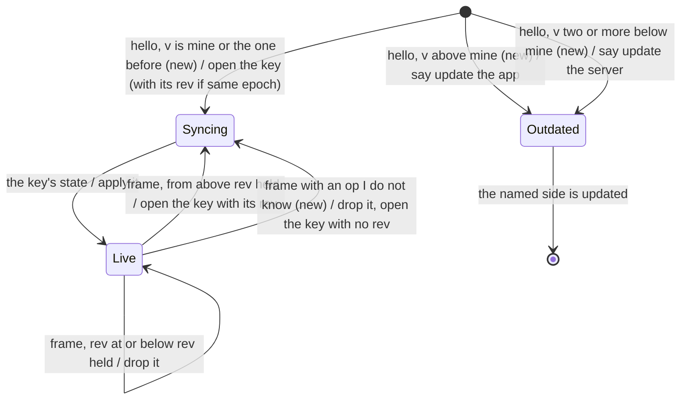
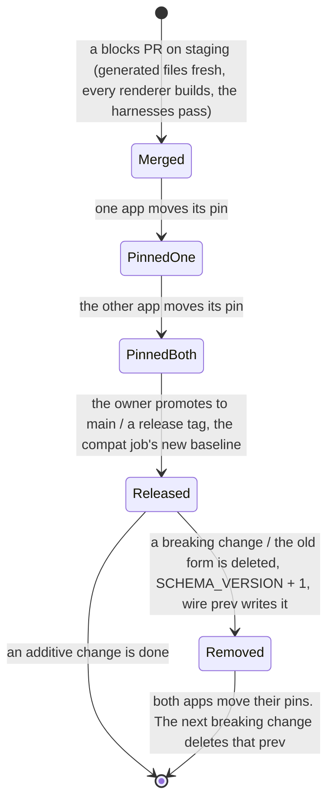

# blocks: module boundaries and the statecharts (#2)

## The repos

```
jirathip-dev/blocks               the rules; names nothing of drover's, cooee's or swag's
      ▲ a dev-dependency (its gate tests)
jirathip-dev/swag                 the looks: every scheme and pack, compiled into its crate
      ▲ apps pin both: blocks by one commit in every manifest, swag by one Cargo rev beside it
drover:  drover-server (Cargo rev) · web/ (npm #sha)
cooee:   cooee-core, cooee-server (Cargo rev) · apple/ (SwiftPM revision)
```

drover and cooee never depend on each other. blocks holds no scheme or pack but its default pair (q2115): an app
takes them from swag's crate, parses them with blocks' types and checks them with blocks' gate and `check_pack`.

## The crate's layers

`.drover/arch.toml` `[[layer]]` rules, checked by `drover arch-check` (they replace blocks#1's four).

```
expr ◄── kind ◄── built ◄── diff  ◄── shelf
           ▲        ▲────── patch ◄── mirror
           │        ▲────── behave, tree ◄── site ──> theme
           └────── wire ◄── diff, patch, shelf, mirror
layout · theme · web: each alone          codegen: uses every layer; nothing uses it
```

| Layer | Owns | May use | Must not |
|---|---|---|---|
| `expr` | `Expr`, `Lit`, `eval` | serde | know a block; panic on any input |
| `kind` | a struct per block kind with its sample, the shared parts (`Fallback`), the generated `Block` | `expr` | know an op, a frame or a renderer |
| `built` | `Built`, `Fault`, `check` | `kind` | diff |
| `wire` | `Op`, `Frame`, `Hello`, `Sync`, `Action`, `Answer`, `Format`, `MediaType`, a frame's SSE text, `old`, `prev` | `kind` | open a socket; name a path or a header |
| `diff`, `patch` | `ops(a, b)`, `apply(screen, ops)` | `kind`, `built`, `wire` | each other |
| `shelf` | the server's half: revs, the ring, a key's state | `built`, `wire`, `diff` | know a device or a stream |
| `mirror` | a client's half: revs held, which frame applies | `built`, `wire`, `patch` | fetch |
| `behave` | `State`, `View`, `view` | `expr`, `kind`, `built` | keep state between calls |
| `tree` | `Node`, `Step`, `Report`, `expect` | `expr`, `kind`, `built`, `behave`, `wire` | measure or draw: no rect comes from here |
| `site` | `page`, `fragment`, `Head`, one writer per kind | `kind`, `built`, `behave`, `theme` | write a `<script>` but the two of `live`; take a string as HTML (every text is escaped) |
| `layout` | `Layout`, `Contract`, `check`, `merge`, `resolved` | serde, serde_json | name a component but `nav`; read a file |
| `theme` | `Scheme`, `gate`, `Style`, `Theme`, `check_pack`, `css`, the default pair | serde, serde_json | draw; read a file; hold a named scheme or a pack (swag's) |
| `web` | `JS`, `CSS` | nothing | |
| `codegen` | the schema, the TS and Swift writers | every layer, `std::fs`, schemars | be linked by an app (`schema` feature) |

The crate's bans stay as blocks#1 wrote them: no tokio, `std::net`, `std::process`, clock, or `std::fs` outside
codegen; no `drover`. This ADR adds `cooee` and `json!` to them. Those bans are also what keeps the core ready for
the wasm build (L2): nothing in `expr`, `diff`, `patch`, `mirror` or `behave` touches the host.

## The TS package

```
gen/types.ts, gen/schemes.ts <── stream.ts          one EventSource, hello, sync, revs (screen-hub)
                             <── patch.ts           ops onto a view through the `draw` it is given (screen-hub)
                             <── theme.ts           the `Theme` port, `packs`, a scheme as CSS
                             <── render/<kind>.ts   one block as DOM, with its hooks from gen/hooks.ts
                             <── behave.ts          `eval` and `view`, as the crate's; binds fields to state
                             <── island.ts          props onto a custom element, its events into actions
                             <── dump.ts            the drawn tree, for the harness
shell.ts ──> all of the above                       the layout's walk: tabs, sheet, kept copies, actions, adopting a static page
web/shot/ ──> the built bundle, Playwright          `blocks-shot` and `shot()`: outside web/src, never bundled
```

| Module | May call | Must not (enforced by) |
|---|---|---|
| `render/*` | `gen`, `theme.ts`, the `Ctx` it is handed | `fetch`, `EventSource`, `localStorage`, `history`, another kind's file but through `render` (bans) |
| `patch.ts` | `gen`, the `draw` it is given | draw a block itself; `fetch` (ban) |
| `stream.ts` | `gen`, `fetch` | touch the DOM (ban on `document`) |
| `theme.ts` | `gen` | `fetch` but for a pack's `sprites.svg` |
| `behave.ts` | `gen` | `eval(`, `new Function` (lint); `fetch` (ban): state never leaves but in an action |
| `island.ts` | `gen` | create a `<script>`, import a URL (ban): the app defines the element |
| `shell.ts` | everything in `web/src` | know a screen's path, a tab's name or an app's block (the `drover` and `cooee` bans) |
| `web/shot` | the bundle, `gen`, Playwright | be imported by `web/src` (ban on `playwright` there) |

`render/index.ts` is a `Record<Kind, Renderer>`: a core kind with no renderer does not compile. A kind HTML does
not draw yet is written `gap(<issue>)`, which draws the fallback, so each gap is one greppable line with its issue.

## The Swift package

| Target | Imports | Holds | Must not |
|---|---|---|---|
| `Blocks` | Foundation | the generated types, `JSONValue`, `Mirror`, `Layout` (with a `Contract`), `Expr` with `eval` and `view` | `import SwiftUI` (ban) |
| `BlocksUI` | `Blocks`, SwiftUI | `BlocksView`, `SlotView`, `Look`, `Palette`, `BlockStyle`, the islands registry, one view per kind | TCA, a store, a URL (ban on `ComposableArchitecture`; the views take closures: `act`, `open`) |
| `BlocksSnapshot`, `blocks-snap` | `Blocks`, `BlocksUI`, AppKit | `Snapshot`: PNG, tree, steps; the CLI over it | be imported by `BlocksUI`; ship in an app (macOS only) |

`BlocksView` switches over the generated `Kind`, exhaustively; a kind SwiftUI does not draw yet is `Gap(<issue>)`.
It wraps every block in one modifier, which applies the app's `BlockStyle`, reports the block to the tree and
registers its tap and binding for scripted input: one place, so a hook, a tree node and a step cannot disagree.
The package builds in Swift 6 mode with complete concurrency checking and warnings as errors, as cooee's does.

## Who may call whom, across repos

| Caller | May call | Never |
|---|---|---|
| an app's server | `blocks::{kind, expr, Built, diff, Shelf, wire, site, layout, theme, web}` | define an `Op`, a `Frame`, a block type of a core kind, a scheme gate or a layout rule of its own; write `json!` |
| an app's page | `mount`, the package's types, `el` and `kids` for its own blocks, its own CSS and custom elements | open an `EventSource`; apply an op; draw a core kind; evaluate an expression |
| an app's Swift code | `Blocks`, `BlocksUI`; `BlocksSnapshot` in its tests | decode a core block by hand; keep its own `JSONValue` |
| an app's verify recipe and perf gate | `blocks-shot`, `blocks-snap`, `report.json` | drive a browser of its own for a blocks screen |
| this repo | serde, serde_json (schemars, esbuild, typescript and Playwright to build and test) | drover, cooee, a transport, a clock |

## Statechart: a key on a client whose version may differ from its server's

screen-hub's page chart (`screen-hub/boundaries.md`), with the transitions this ADR adds, marked `new`. The crate's
`Mirror`, `stream.ts` and the Swift `Mirror` all follow it and run `fixtures/protocol/`.



The client names its version when it opens the stream, and the server answers `hello` with the lower of the two, or
with its own lowest when the client is further behind. In `Outdated` the client shows its last copy and one line.
It does not sync, so it never applies ops it could misread. Local state (`renderers.md` section 3) is kept through
every transition but a whole new screen.

The charts of one block, a field's checks, an island and a static page being taken over are in `renderers.md`.

## Statechart: a layout (cooee's, now for both shells)

```mermaid
stateDiagram-v2
    [*] --> Default: no layout.json
    [*] --> Good: the file passes the check
    [*] --> BrokenLast: it fails (the default is served)
    Default --> Good: a write that passes / changed
    Good --> Good: a write that passes / changed
    Good --> BrokenLast: a write that fails / broken, with its line and why. The last good one stays served
    BrokenLast --> Good: a write that passes / changed
    Good --> Default: reset / the old file kept as .bak
```

A client keeps the last layout that decoded and draws it until a newer one decodes. The file watch, the routes and
the reset are the app's; the states and `check` are this repo's.

## Statechart: a change to the wire, across the three repos



Between `Merged` and `PinnedBoth` the apps run different blocks commits against each other, and an installed app
may stay a release behind for months. The versioning table (`shapes.md`) and `compat.yml` are what make that safe.
