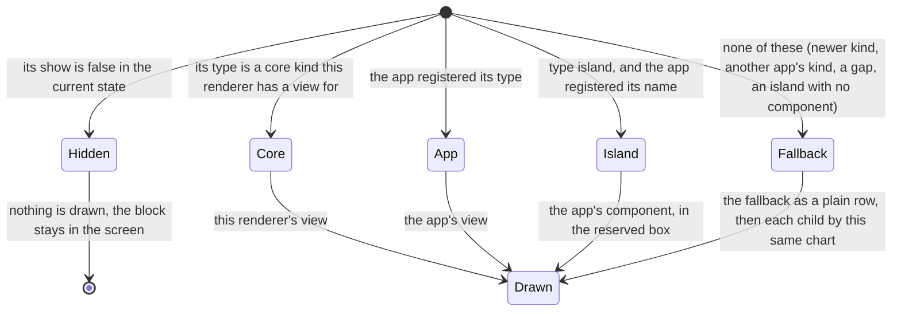
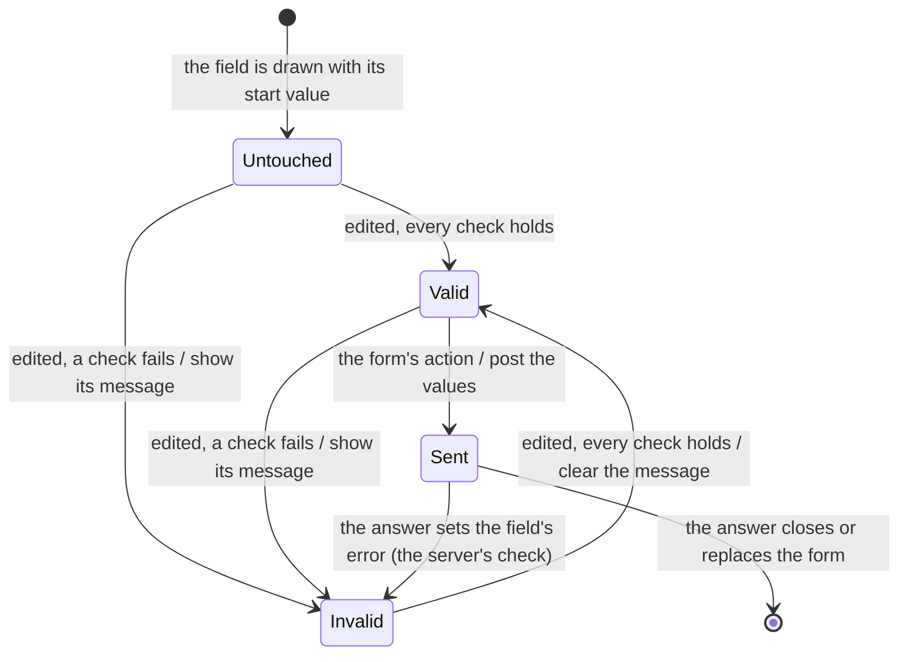
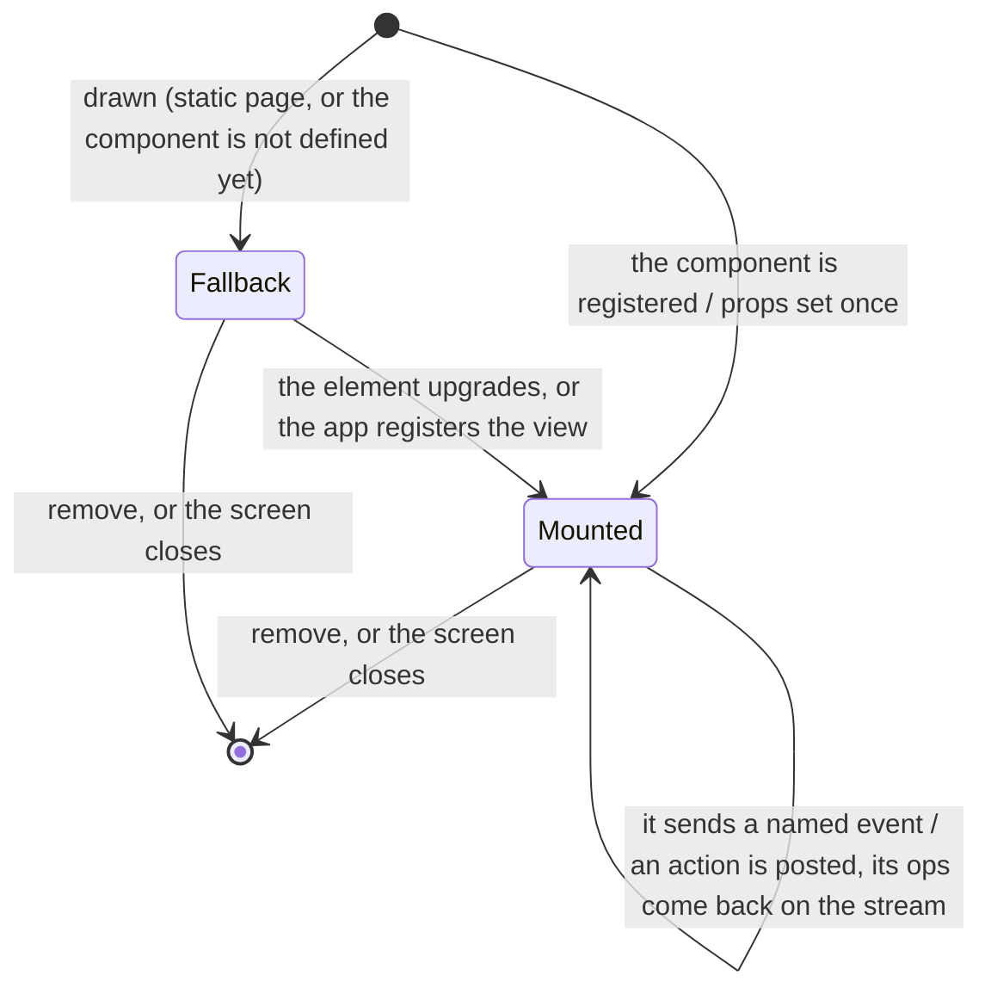
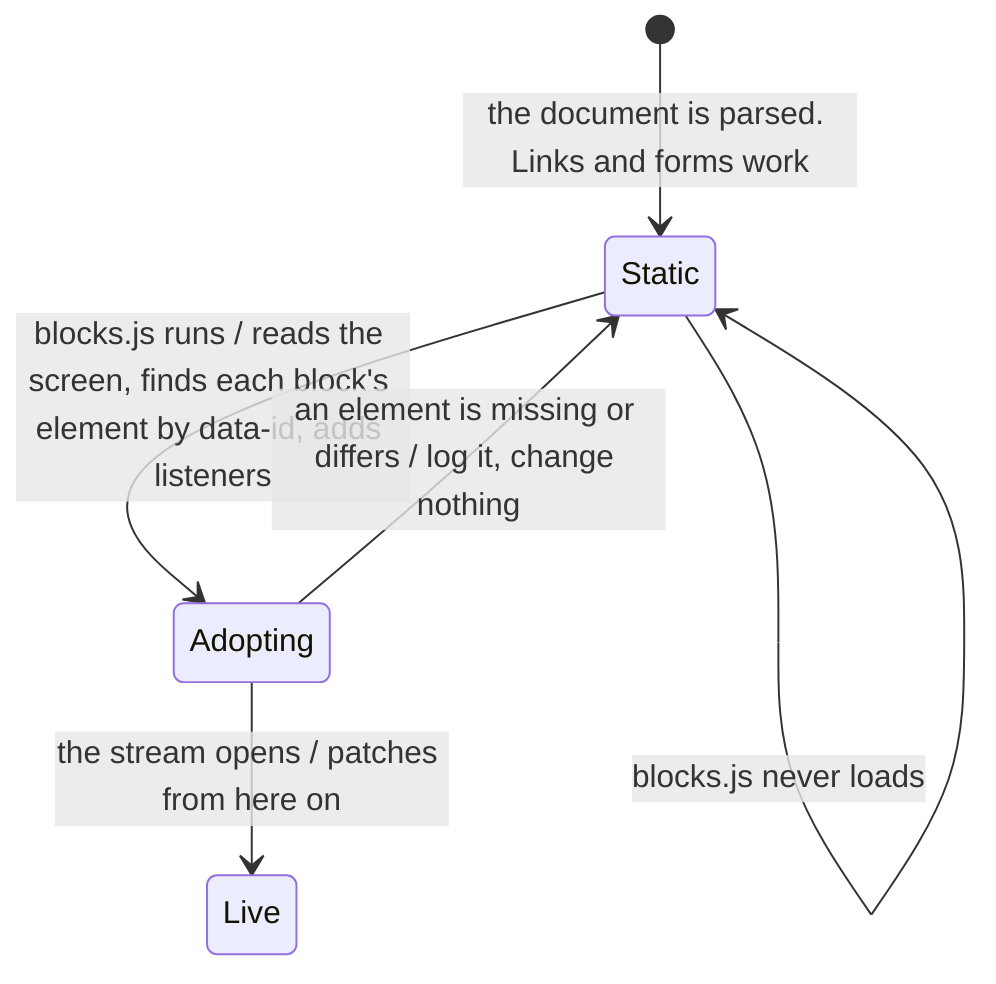

# blocks: what every renderer must do (#2)

The renderer contract, written without TS or Swift so that a third renderer can be held to it (q2069). Three exist
after this plan: live HTML (`web/src`), SwiftUI (`BlocksUI`) and static HTML (`crates/blocks/src/site`).

## 1. One block, as a renderer meets it



No path ends in an error or in nothing: a block a client cannot draw shows its fallback (q2064). A block with no
fallback and no view can only come from a server that skipped `Built::check`; its children are still drawn.

## 2. Style hooks (q2061)

An app changes the look in two steps and never edits a renderer.

**Tokens.** `Scheme` (colours) and `Style` (type, spacing, radius, motion, surface). On the web `theme::css` writes
each as a CSS variable; in SwiftUI they are the `Look` in the environment.

**Hooks.** Stable names, generated from each kind file's `variant` and `parts`:

| | Web (both HTML writers) | SwiftUI |
|---|---|---|
| a block | `class="b b-<kind>"`, `data-block="<kind>"`, `data-id` | `.blockStyle(.row, MyRow())` |
| its variant and tone | `data-variant` (row `style`, card `kind`, button `style`, text `style`, images `size`), `data-tone` | `StyledBlock.variant`, `.tone` |
| a part | `class="b-<kind>__<part>"`: `title`, `subtitle`, `badge`, `value`, `figure`, `actions`, as the kind lists | not exposed: the content is opaque |
| drawn as a fallback | `data-fallback` | `StyledBlock.fallback` |
| an app kind | `b b-app b-<kind>`, the same attributes | the same `.blockStyle("herd", …)` |

```swift
public protocol BlockStyle { associatedtype Body: View; @ViewBuilder func body(_ block: StyledBlock) -> Body }
public struct StyledBlock { public let kind: String, id: String?, variant: String?, tone: Tone?, fallback: Bool; public let content: AnyView }
```

- The core CSS is in `@layer blocks`. An app's stylesheet is outside it, so its rule wins by the cascade.
- A `BlockStyle` wraps the drawn content (padding, background, font, tint, shape); it cannot reach inside it.
- Anything not in the table is private and may change: an element without a hook class, a view's inner layout.
- The gate is the app's headless run with its own styles (section 6): a block squeezed to nothing, pushed off the
  screen or over its sibling fails `--check` there.

## 3. Behaviours (q2067)

The shapes are in `shapes.md`. Every renderer runs the same loop:

1. State starts from the screen's `state` and each field's `value`.
2. `view(screen, state)` gives the hidden blocks, the disabled controls and each failing field's message.
3. A typed character, a toggle, a pick or a tap's `set` changes state; go to 2. Nothing is sent.
4. An op changes the screen; go to 2 with the same state.



A form's submit is disabled while a field is `Invalid`, or `Untouched` with a failing check. The static page draws
step 2 once, on the start state: a hidden block gets the `hidden` attribute, `is filled` becomes `required`, `is
email` becomes `type="email"`, a length bound becomes `maxlength`. The rest waits for the server's answer.

## 4. Islands (q2067)

| | Web | SwiftUI | Static page |
|---|---|---|---|
| the component | a custom element whose tag is the island's `name`, defined by the app's own script | a view the app registers: `.islands(["x-chart": { props, send in … }])` | none |
| props in | the element's `props` property, set at mount and after each `merge` | the closure's `props`, a `JSONValue` | a `data-props` attribute, for the element to read when it upgrades |
| events out | it dispatches `blocks-event` with `{ name, values }`; the renderer posts an `Action` if `name` is in `events` | it calls `send(name, values)` | none |
| before it is there | the fallback, as the element's children, in the reserved `size` | the fallback | the fallback, as the element's children |



- An island differs from an app kind in its life: an app kind is redrawn from its fields on every patch; an island
  is one instance with its own state, and only its props change.
- blocks never fetches or evaluates a component. A name nobody registered is a fallback, not an error.
- An event's name outside `events` is dropped and counted in the harness's report.

## 5. The static page and taking it over (q2060)

`site::page` writes one document:

```html
<html lang="en"><head>
  <title>…</title><meta name="description" …><link rel="canonical" …><meta property="og:title" …>   <!-- Head -->
  <style>:root{--bg:#fbf8f1;…}@media (prefers-color-scheme: dark){:root{…}}</style>                 <!-- theme::css -->
  <link rel="stylesheet" href="/blocks.css"><link rel="stylesheet" href="/app.css">
</head><body>
  <main class="b b-screen" data-block="screen" data-id="home"> … every block, by section 1 … </main>
  <script type="application/vnd.blocks+json" id="blocks-screen">{…}</script>        <!-- only with `live` -->
  <script type="module" src="/blocks.js"></script>                                  <!-- only with `live` -->
</body></html>
```

- **Works with no JS.** `tap.open` and `tap.url` are `<a href>`. An action is a `<form method="post">` with its
  values as hidden inputs; a `form` block is one `<form>` with its fields as inputs. The app's server reads the post
  with `Action::from_form`, runs it and redirects. Without `live` the page has no script at all.
- **One markup.** For every kind, `fixtures/html/<kind>.html` is what `site` writes for `fixtures/blocks/<kind>.json`
  (generated), and the browser test fails unless `render` gives the same element for the same fixture.



- **No flash.** Adopting writes nothing to the DOM. The gate is headless: the PNG and the tree of the fixture site
  before `blocks.js` runs and after it are equal.
- Once `Live`, a tap that has an action posts in place instead of leaving the page; an `<a href>` stays a link.

## 6. Headless (q2058)

One contract, one harness per renderer. Its shapes are Rust types in `tree.rs`, generated for TS and Swift.

```
blocks-shot  (HTML, WebKit)   ·   blocks-snap  (SwiftUI, macOS)
  --screen <file>  [--layout <file>]  [--scheme <name>]  [--style <file>]  [--size 390x844]
  [--css <file>]…  [--static | --adopt]                          HTML only: an app's CSS; the page with no JS; taken over
  [--script <steps.json>]  [--expect <tree.json>]  [--check]  --out <dir>
  → <dir>/<shot>.png, <dir>/<shot>.tree.json, <dir>/report.json; exit 1 when a check fails
```

```rust
pub struct Node { pub kind: String, pub id: Option<String>, pub variant: Option<String>, pub drawn: Drawn,
                  pub rect: Option<[f64; 4]>, pub text: Option<String>, pub children: Vec<Node> }
pub enum Drawn { Native, Fallback, Hidden }
pub enum Step { Tap { id: String }, Type { id: String, text: String }, Scroll { id: String },
                Frame(Frame), Answer(Answer), Shot { name: String } }      // a stream frame arrives; an action is answered
pub struct Report { pub shots: Vec<String>, pub sent: Vec<Action>, pub dropped: Vec<String>, pub timings: Timings }
pub struct Timings { pub first_paint_ms: f64, pub steps_ms: Vec<f64>,                 // the frame fields: optional, additive
                     pub longest_frame_ms: Option<f64>, pub frames_over_budget: Option<u32>, pub longest_patch_ms: Option<f64> }
pub fn expect(screen: &Built, kinds: &[&str], state: &State) -> Node;      // the tree to draw: no rect, no text
```

- **PNG**: WebKit's screenshot at the given size; `ImageRenderer` at scale 2, as cooee's frames are made today.
- **Tree**: every block as section 1 resolved it, in drawn order. The web dump walks `[data-block]`; SwiftUI
  collects it from the wrapper that also applies the `BlockStyle`. A renderer that draws a block without its hook
  is caught here.
- **Input** is by block id. WebKit gets real events on the element; SwiftUI calls the handler or binding the block
  registered with the same wrapper. The harness answers actions from the script and never opens a network.
- **`--check`**: the tree equals `--expect` in kind, id, order and `drawn`; every drawn node has a size; none leaves
  the screen's width; no two siblings overlap. `fixtures/trees/` holds the expected tree of every fixture.
- **Frames** (q2112): `blocks-shot` meters each animation frame's main-thread time (its tasks, `rAF`, style, layout
  and paint) through a `scroll` step (a smooth scroll to the block) and a run of `frame` steps (played as a burst, 60
  a second): `longest_frame_ms`, `frames_over_budget` (over 16.7 ms) and `longest_patch_ms` (the patcher's one pass in
  a frame). `blocks-snap` draws no real frames: its `steps_ms` is each step's main-thread time, the frame fields absent.
  This repo's gate: the 200-row screen keeps every frame in 16.7 ms and each patch in 4 ms.
- **Batching**: every op that arrives within one animation frame is applied in one pass before the next paint, so a
  burst costs one layout: `stream.ts` hands a key's frames to the view once per frame, the patcher draws them in one
  pass, and the Swift `Replica.frames` takes a burst in one mutation.
- **Motion**: CSS animates `transform` and `opacity` only, its durations scaled by `--motion` (the `motion` token), and
  stops under `prefers-reduced-motion`; `web/lint.mjs` refuses any other property. SwiftUI scales its animation
  durations by `look.style.motion`.
- **Test API**, the same thing in process: `shot({ screen, steps })` from `web/shot`, `Snapshot(screen).run(steps)`
  from `BlocksSnapshot`. An app with SwiftUI styles or islands uses the API, since a CLI cannot load its views.
- **Who calls it**: this repo's `web.yml` and `swift.yml` for every fixture; `compat.yml` (the last release's
  harness, today's fixtures); an app's verify recipe and its perf gate, which reads `report.json`'s timings.

## 7. Conformance

A renderer conforms when its harness passes, on every file of `fixtures/`:

| Fixtures | It proves |
|---|---|
| `blocks/` with `trees/` | each kind is drawn, with its hooks, or shows its fallback |
| `protocol/` | frames, resync and versions end in the same screen as the crate's `Mirror` |
| `behave/` | every expression has the same value as the crate's `eval` |
| `screens/` with scripts | taps, typing, `set`, checks and islands send the same actions |
| `site/` (HTML only) | the page works with no JS and is taken over with no change |

Later renderers pass the same files: the Rust desktop renderer (L1), and any renderer on the wasm core (L2), which
replaces the TS and Swift copies of `patch`, `mirror` and `eval` with the crate's own.
