# Boundaries

## Which module may call which

| Module | May use | May not | Enforced by |
|---|---|---|---|
| `web/src/shell/mount.ts` | a `Source` (from `sources`, else `served`), `host`, the sheet, the toasts | `fetch(`, `stream(` | two new bans in `.drover/arch.toml` |
| `web/src/shell/source.ts` | `stream.ts`, `render/ctx.ts`'s `posted`, the generated types | the DOM | review; it holds the only `fetch(` a mounted shell makes |
| `web/src/shell/local.ts` | `core/apply.ts`, the generated types, the `Source` type | `fetch(`, `stream(`, the DOM, the patcher | the same two bans; the existing `patcher(` ban on `web/src/shell/**` |
| `web/src/stream.ts`, `web/src/patch.ts`, `web/src/core/**` | as today | as today | unchanged |
| `web/src/shell/adopt.ts` | as today: its own stream and POST | | unchanged: a page `site` wrote is served by definition |
| `demo/client/src/lib.rs` (the app) | the `blocks` crate's public surface | its own glue | the crate has no `pub(crate)` door; the native tests run it with no glue |
| `demo/client/src/glue.rs` | the app, `serde_json` | an `unsafe` block, a dependency | review; `cfg(target_arch = "wasm32")` keeps it out of the native tests |
| the `blocks` crate | as today | `demo/`, a wasm or FFI tool | the crate's manifest does not change; `core/deps` holds its list |
| `swift/Sources/**` | as today | | unchanged: no Swift source changes |

The rule behind the table: the shell draws what a `Source` hands it and never asks where it came from. Only
`served` talks to a server; only `local` talks to the app.

## What crosses the app's boundary

JSON text, in the wire's own shapes and nothing else: a `Block` (the whole screen), `Op[]`, an `Action`, an
`Answer`. No new message type, no rev, no handshake. The app and the renderer are one pin, so there is no version
to negotiate.

## Statechart: one path of a local source

```mermaid
stateDiagram-v2
    [*] --> closed
    closed --> opening: open(path, on) / ask app.screen(path)
    opening --> live: the screen arrives / keep it, on(screen)
    opening --> opening: push or an answer's ops / dropped
    opening --> closed: close(path) / app.close(path); a late screen is dropped
    live --> live: ops that fit / screen = apply(screen, ops), on(screen, ops)
    live --> opening: ops that do not fit / ask app.screen(path) again
    live --> closed: close(path) / app.close(path)
    closed --> closed: push / dropped
```

- **Ops dropped while opening are not lost.** `screen(path)` returns the screen as it is now, so it already holds
  them. This asks one thing of the app: answer in the order things happened. Wasm in the page does by nature (every
  call returns before the next); an app that runs its Rust in a worker gets it from the worker's message order.
- **"Do not fit" is the stream's gap.** `apply` returns nothing when an op names a block that is not there. The
  source then takes the whole screen again, as `stream.ts` asks the server again. An app whose bookkeeping slips
  heals on its next change.
- **An action's answer is two things.** Its `ops` go through this chart, to the path the action came from. The
  rest (`toast`, `open`, `close`) goes to the shell as a server's answer does.
- **One callback per path**, as a stream has one per key: the same path shown twice on one page is drawn by the
  later view only. That limit is today's and stays.

Swift has no chart of its own: the app holds the `Block`, and `Block.apply` either changes it or throws, in which
case the app decodes the whole screen again (`usage.md`, section 5).
