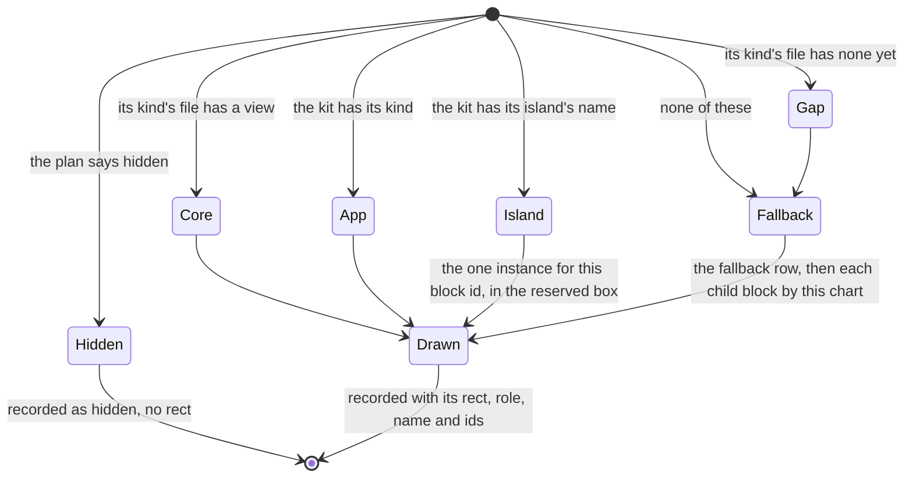
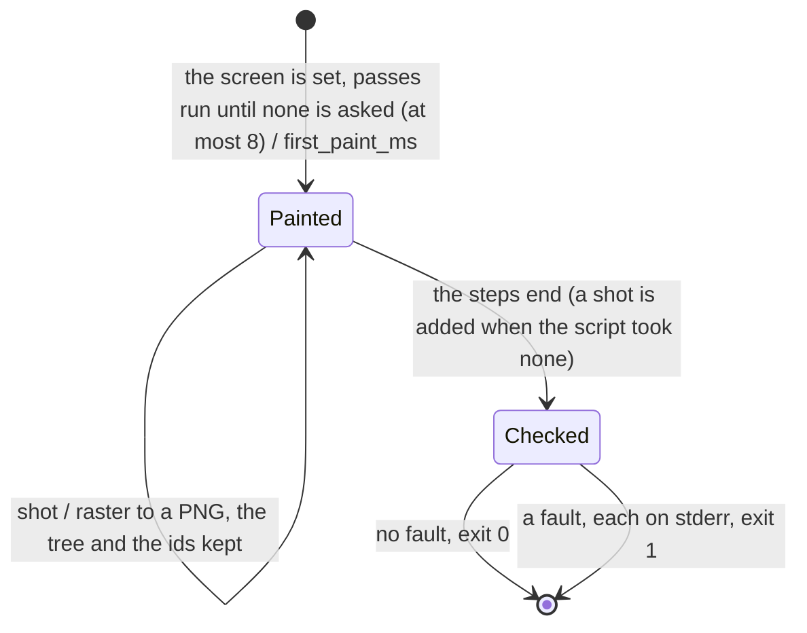

# The desktop renderer: shapes, boundaries, statecharts, slices (#45)

## Two crates

```
crates/blocks            serde, serde_json            unchanged but for `Block::kind()`
   ▲
crates/blocks-desktop    blocks, egui                 the renderer: a library, pure (no file, clock, process or window)
   ▲
crates/blocks-desk       blocks, blocks-desktop, egui the harness: a library (`Desk`) and the `blocks-desk` binary
```

The app's window crate (eframe) is in no manifest of this repo.

## Data shapes

```rust
// crates/blocks-desktop: the public surface, all of it
pub struct Stage { /* one screen on this client: the screen, its local state, what the last pass drew */ }
impl Stage {
    pub fn set(&mut self, screen: Option<&Block>);       // a screen or an op landed; `None` when the key closes
    pub fn show(&mut self, ui: &mut egui::Ui, kit: &Kit, unix_now: f64) -> Vec<Event>;   // one pass
    pub fn drawn(&self) -> Option<&Drawn>;               // the last pass, for the harness and an app's own test
    pub fn state(&self) -> &State;                       // `blocks::expr::State`
}

pub enum Event { Act(Action), Open(String), Sheet(String), Thread(String), Refresh, Dropped(String) }

pub struct Look { pub schemes: PerMode<Scheme>, pub mode: Option<Mode>, pub style: Style, pub still: bool }
pub trait Art { fn figure(&self, f: &Figure, ui: &mut egui::Ui) -> bool; fn word(&self, key: &str) -> Option<&str>; }
pub struct Plain;                                        // no art: each state's glyph, the plain words
pub struct Pack(pub blocks::theme::Theme);               // a pack's words; its sprites wait for an SVG reader

pub struct Kit { /* look, art, app kinds, islands, wraps */ }
impl Kit {
    pub fn new(look: Look) -> Self;
    pub fn art(self, art: impl Art + 'static) -> Self;
    pub fn kind(self, name: &str, draw: impl Fn(&mut egui::Ui, &AppBlock, &mut Out<'_>) + 'static) -> Result<Self, Clash>;
    pub fn island<I: Island + 'static>(self, name: &str, make: impl Fn() -> Box<I> + 'static) -> Self;
    pub fn wrap(self, kind: &str, wrap: impl Fn(&mut egui::Ui, &Styled<'_>, &mut dyn FnMut(&mut egui::Ui)) + 'static) -> Self;
}
pub struct Clash { pub kind: String }                    // an app kind named like a core kind
pub struct Styled<'a> { pub kind: &'a str, pub id: Option<&'a str>, pub variant: Option<&'a str>, pub tone: Option<Tone>, pub fallback: bool }
pub trait Island { fn show(&mut self, ui: &mut egui::Ui, props: &Fields, out: &mut Out<'_>); }
pub struct Out<'a> { /* send(name, values): an Action when `name` is in the block's `events`, else Dropped */ }

pub struct Drawn { pub tree: tree::Node, pub blocks: Vec<String>, pub actions: Vec<String>, pub hits: BTreeMap<String, Hit> }
pub struct Hit { pub rect: [f64; 4], pub tap: Option<[f64; 4]>, pub field: Option<[f64; 4]>, pub live: bool }
pub fn kinds() -> Vec<&'static str>;                     // the core kinds drawn natively: every `draw/<kind>.rs` with `Some`
```

```rust
// crates/blocks-desk: the harness. Its file shapes are the crate's own: tree::{Node, Step, Report, Timings}
pub struct Desk { /* screen, size, kit */ }
impl Desk {
    pub fn new(screen: Block) -> Self;
    pub fn size(self, width: u16, height: u16) -> Self;  // default 390x844, scale 1
    pub fn kit(self, kit: Kit) -> Self;
    pub fn run(self, steps: &[Step]) -> Run;
}
pub struct Run { pub report: Report, pub shots: Vec<Shot>, pub faults: Vec<String> }
pub struct Shot { pub name: String, pub png: Vec<u8>, pub tree: tree::Node, pub ids: Ids }
pub struct Ids { pub blocks: Vec<String>, pub actions: Vec<String> }                   // a `fixtures/ids` file
pub struct Want { pub tree: Option<tree::Node>, pub ids: Option<Ids> }                 // `--expect`, `--ids`
impl Run { pub fn check(&mut self, want: &Want); }       // fills `faults`: the tree, sizes, the width, overlaps, the ids
```

- No new wire type, no schema change, no generated file: the harness reads and writes the shapes `tree.rs` has.
- The one addition to the `blocks` crate is `Block::kind() -> &str`, from the `kinds!` list that already names them.
- `Timings`: `first_paint_ms` and `steps_ms` are whole passes (layout, tessellation, raster). The frame fields are
  filled, as `blocks-shot` fills them: `longest_frame_ms` and `frames_over_budget` over `scroll` steps and `frame`
  bursts, `longest_patch_ms` the longest `apply` with its `view`.

## What `set` prepares and what a pass does

`set` runs once per screen or op, never per frame: it keeps the `Block`, builds its `Built`, and works out the
**plan**: `tree::expect(&built, &kinds(), &state)`, the crate's own answer for every block: hidden, native or
fallback, its variant, its role and its name. The plan is worked out again when the local state changes.

A pass walks the typed `Block` through the switch. Every block goes through one wrapper, `Cx::block`, which:

1. reads the block's place in the plan: hidden draws nothing;
2. opens a child `Ui` whose egui id comes from the block id, so focus and scroll follow a block through a move;
3. calls the app's `wrap` for the kind, if any, around the content;
4. draws the content: the kind's `DRAW`, the app's kind, the island, else the fallback row and then the child blocks;
5. gives the accessibility node the plan's role and name, and the author id `block:<id>`;
6. records the node with its rect in `Drawn`, from what was really drawn, not from the plan.

So what is hidden and what each block is called come from the crate, and the harness still catches a view that
skips a child, draws it twice, draws it out of order or leaves it with no size: `Drawn.tree` then differs from
the plan.

## Module boundaries

`A → B`: A may use B. Nothing else is allowed. The layer lines are in `adr.md`; arch-check tested them on a scratch
copy with one breach of each rule.

```
crates/blocks-desktop/src
  look.rs  art.rs  text.rs      tokens to egui values, the `Theme` port, md and ages       → blocks (theme, kind)
  cx.rs  drawn.rs  act.rs       the wrapper and the pass context, the recorder, taps       → look; blocks::tree
  fallback.rs  island.rs        the fallback row, island instances                         → look
  draw.rs                       the switch: one arm per `Block` variant, `kinds()`         → look; its own `draw/` files
  draw/<kind>.rs                one view per core kind                                     → look, cx, drawn, act, fallback, island
  stage.rs  lib.rs              `Stage`, `Kit`: state, the plan, one pass                  → all of the above; blocks::{behave, tree}

crates/blocks-desk/src
  lib.rs  steps.rs  fit.rs      `Desk`, the steps, the checks                              → blocks_desktop's public items; blocks::tree
  raster.rs  png.rs             egui's triangles to RGBA; RGBA to a PNG                    → egui
  stopwatch.rs                  the one file that reads a clock
  main.rs                       the CLI: the one file that reads and writes files
```

| Rule | Enforced by |
|---|---|
| a view never evaluates an expression, reads the stage or the plan, or sends on its own: it gets `Cx` | arch-check layers: a `draw/` file may use `desktop-look` and `desktop-cx` only |
| no second `patch`, `mirror` or `eval` | the layers above (only `stage` reaches `blocks::behave`); `fixtures/protocol` and `fixtures/behave` run through `Stage` and must end in the crate's results |
| the renderer is pure: no file, clock, process or socket | the existing bans on `crates/*/src/**`; `unix_now` is an argument |
| the renderer opens no window and names no window or GPU crate | a new ban on `eframe`, `winit`, `wgpu`; `deny.toml` bans the three crates |
| the blocks crate links no toolkit | a new ban on `egui` in `crates/blocks/**`; the deps gate; AC 4 |
| the harness is no part of the renderer | cargo: `blocks-desktop` has no edge to `blocks-desk` |
| every core kind has a file; a gap is visible | the switch is an exhaustive `match`; `DRAW: None` carries `TODO(#N)` |
| files stay small | the `[[size]]` rule on `crates/*/src/**`: 1,000 lines a file, 80 a function |

## Statecharts

**A stage** (one screen on one client). The field chart inside `Held` is `renderers.md` 3, unchanged.

```mermaid
stateDiagram-v2
    [*] --> Empty
    Empty --> Held: set(screen) / state = behave start, the plan
    Held --> Held: set(screen), an op landed / the same state, the plan again
    Held --> Held: show, an edit or a tap's set / state changes, the plan again, one more pass asked
    Held --> Held: show, a tap with an action / Event Act; nothing changes until its ops arrive by set
    Held --> Held: show, nothing happened / no event, no pass asked
    Held --> Empty: set(None), the key closed / state and islands dropped
```



**One block in a pass.** `renderers.md` 1, with the gap named:



An island's life is `renderers.md` 4: its instance is made on the first pass that draws it and dropped on the first
`set` whose screen no longer holds its block id.

**A harness run.**



The harness runs still: egui's animation time is 0, so a scroll lands in one pass and a PNG never catches a fade.

## Slices

Each is one PR that leaves every gate green. Lines are non-test Rust, as the cap counts them.

| # | Slice | It adds | Lines |
|---|---|---|---|
| S1 | bones | `blocks-desktop` and every shared-file edit (the lines at the end of `adr.md`, `just desktop`, one README line); `Stage`, `Cx`, the recorder, `Look`, the fallback, the switch with all 27 kind files; `screen`, `section`, `list`, `row`, `text` drawn; its tests hold `Stage::drawn` to `tree::expect` on every `fixtures/blocks` and `fixtures/stress` file | 1,300 |
| S2 | harness | `blocks-desk`: `Desk` and the CLI with the tree, `tap`, `frame`, `answer`, `shot`, `--check`, `--ids`; `desktop.yml` on Linux, Windows and macOS | 370 |
| S3 | pixels | the rasteriser and the PNG writer; the frame timings; the perf gate on the 200-row screen (every pass in 16.7 ms, each patch in 4 ms) | 490 |
| S4 | controls | taps (`act.rs`), `button`, `card`, `chips`, `stat`, `choice`, `run`; the `Art` port; ages; `fixtures/behave`'s view cases and `fixtures/ids` | 790 |
| S5 | forms | `form`, `config`, `secret`, `sheet`; the `type` step; the action ids | 410 |
| S6 | apps | app kinds, islands (with the harness's echo island), wraps; `fixtures/protocol` through `Stage`; `docs/desktop.md`; `desktop` added to the release workflow's list | 220 |
| | | | 3,580 |

Kinds left as gaps, each drawn by a later issue that edits one file: `prose`, `hero`, `nav` (about 250 lines);
`images`, `media` (200, and an image decoder, which is a dependency ask); `diff`, `editor` (260); `scene` (90);
`diagram` (350); `composer` (200). `web` stays a fallback with its link: egui has no web view.
