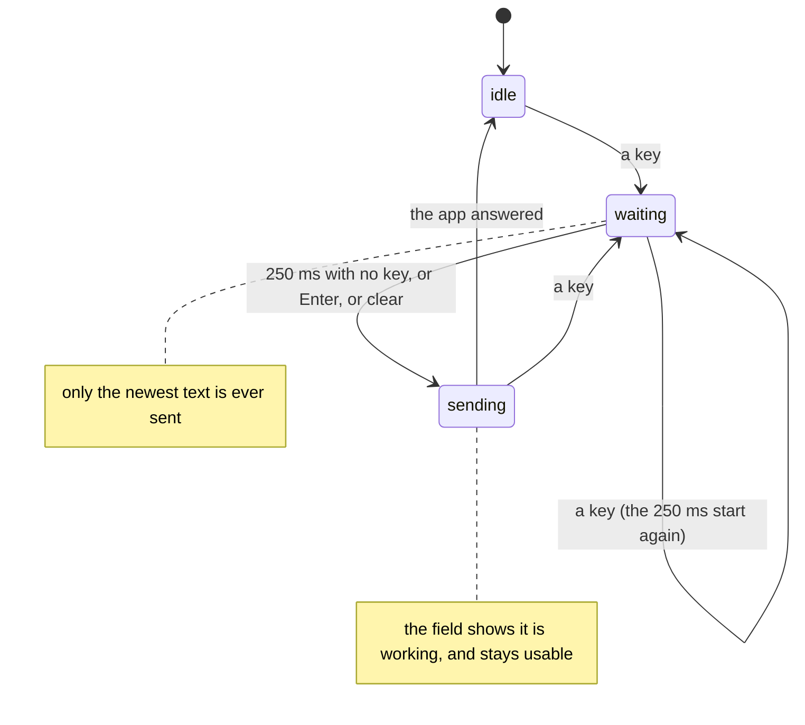
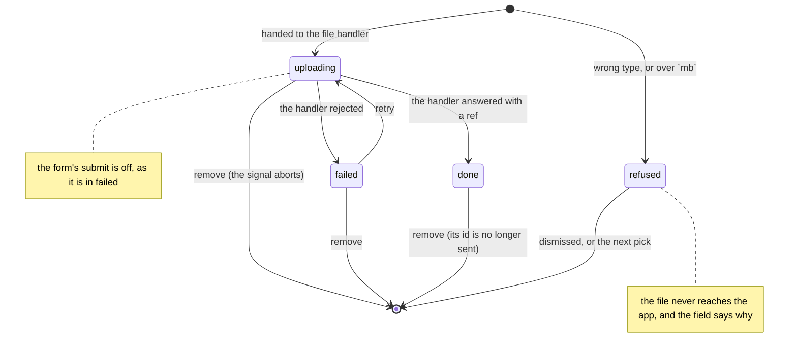
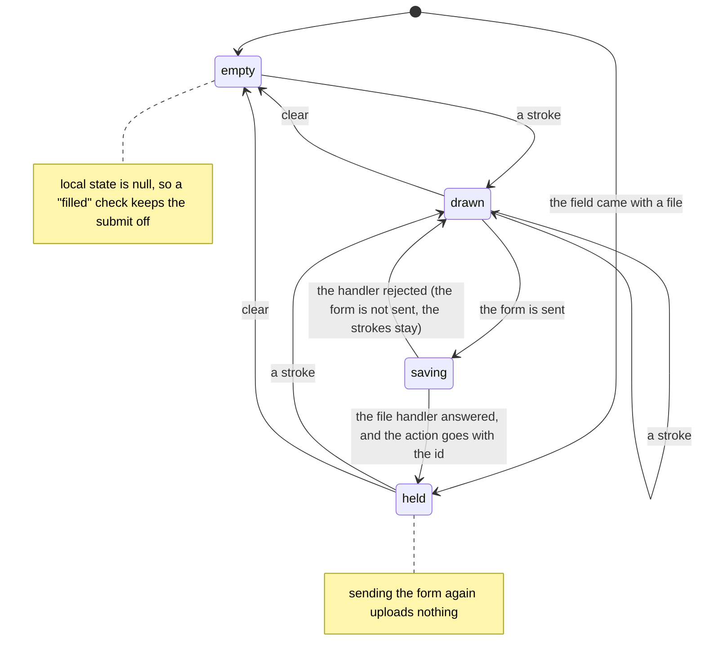

# Boundaries

## Which module may call which

```
an app ──▶ the builders (typed fields) ──▶ a renderer's form ──▶ field/<type> (one view per type)
                                                 │                    │
                                                 ▼                    ▼
                                      behave: start, view, lit    core/field: calendar, match, files, rich   (web)
                                                 │                kind/locale: day(), the words              (all)
                                                 ▼
                 onAction / act (JSON only)            onFile / file (bytes only)
```

| Module | May use | Never | Enforced by |
|---|---|---|---|
| `kind/field/**`, `kind/locale.rs` | `expr`, the rest of `kind` | a clock, a file, the device's locale | the `kind` layer and the crate's bans, as today |
| `behave` (`lit`) | `kind`, `expr`, `built` | | the layer rule; `fixtures/behave/fields.json` in three languages |
| `site/field/**` | `kind`, `behave`, `tree`, `theme` | script | the `site` layer; `fixtures/site/` |
| `web/src/core/field/**` | `gen/` | the DOM, the clock, `Intl` | the core's bans (#81) and the two new ones below; its tests run in node |
| `web/src/render/field/**` | the core, `gen/`, the render helpers | another type's file, `fetch`, the clock, `Intl`, base64 | the `fetch(` ban already on `render/`; the new bans |
| `web/react/src/fields/**` | the core, `gen/`, `react` | the HTML renderer, `fetch`, the clock, `Intl`, base64 | #81's bans; the new bans |
| `swift/Sources/BlocksUI/Field/**` | `Blocks`, SwiftUI | `Date()`, `Locale.current`, `URLSession` | the new bans |
| a form (in each renderer) | the generated table of field views | a type's name | it has no `if type is…`; a new type edits no form file |

Two types that share a part (date and days share the calendar, combo and tags the list) share it from a file that
is no type: `core/field/calendar.ts`, `render/field/_list.ts`. A name starting with `_` is not a type.

## The field contract: what every renderer does for every type

1. **The row.** Label, note (the error, else `was`, else `doc`), then the control. Its root carries
   `data-field="<name>"` and `data-type="<type>"`, plus `data-plain` when the type has no view here.
2. **A role and a name** on the control, checked in the drawn tree like every block's:

   | Type | Role | Also |
   |---|---|---|
   | search | `searchbox` | a clear button named "clear" |
   | slider | `slider` | min, max, now and the label's text as its value text |
   | upload | `group` | an add button; each file is a list item with its state and a named remove button |
   | signature | `img`, named by the label and "empty" or "signed" | a clear button |
   | date, days | `button` showing the day, opening a `dialog` with a `grid` | previous, next and today buttons |
   | hours | `group` of two `combobox`es | the worked hours as a status line |
   | combo, tags | `combobox` with a `listbox` | each tag a named remove button |
   | text with `rows` | `textbox`, multi-line | rich: a toolbar of three pressed-or-not buttons |

3. **Local state through `lit`.** On every change the view reports what it holds; the form stores `lit(field, held)`
   under the field's name. No view works out hours or counts itself.
4. **Nothing from the device.** Today, the language and the era come from the screen's `locale`; days and numbers
   are drawn by `day()` and the fixed number rules of #80.
5. **Bytes only through the file handler; an action carries JSON only.**
6. **A screen that changes under a field keeps it.** When the app answers a search or a `load` with a new screen,
   the field with the same form id and name keeps its typed text, its focus and its open list. React does this by
   itself. The HTML patcher learns it once, for every field: it puts the focus back on the same name after it
   redraws a form.
7. **Drafts.** Text, search, slider, date, days, hours, combo and tags keep a draft in the store, as text does
   today. Upload and signature keep none: after a reload they show the field's `files` or `file`.

Harness steps added to `blocks-shot` and `blocks-snap`, the same words in both: `slide` (a field, a number),
`choose` (a field, an option or a day), `file` (a field, a name, a size, a type, and whether the handler answers,
fails or waits) and `draw` (a field: one stroke).

## How a value leaves

| The form has | A field leaves |
|---|---|
| a `submit` | with every other field, when it is pressed |
| an `action` (a live form) | alone, as `{ name: value }`, each time it is committed |
| neither | never: the form is local (a search with `filters`, a slider read by a `show`) |

| Type | Committed when |
|---|---|
| toggle, picker, combo, tags, date | a value is picked |
| days | the second day is picked |
| hours | either time is picked |
| slider | the thumb is let go |
| text | the field is left, or Enter in a one-line one (as `config` does today) |
| search | 250 ms after the last key; at once on clear and on Enter |
| upload | a file finishes or is removed |
| signature | never by itself: only a submit sends it |

## Statechart 1: a typing sender (a search in a live form, a combo's `load`)



An answer to an older text may still arrive. The app's screen is the truth, so the renderer draws what it is
handed and keeps the typed text.

## Statechart 2: one picked file



A file given in the field's `files` starts in `done`. Without `many`, a new pick replaces the one file.

## Statechart 3: a signature


