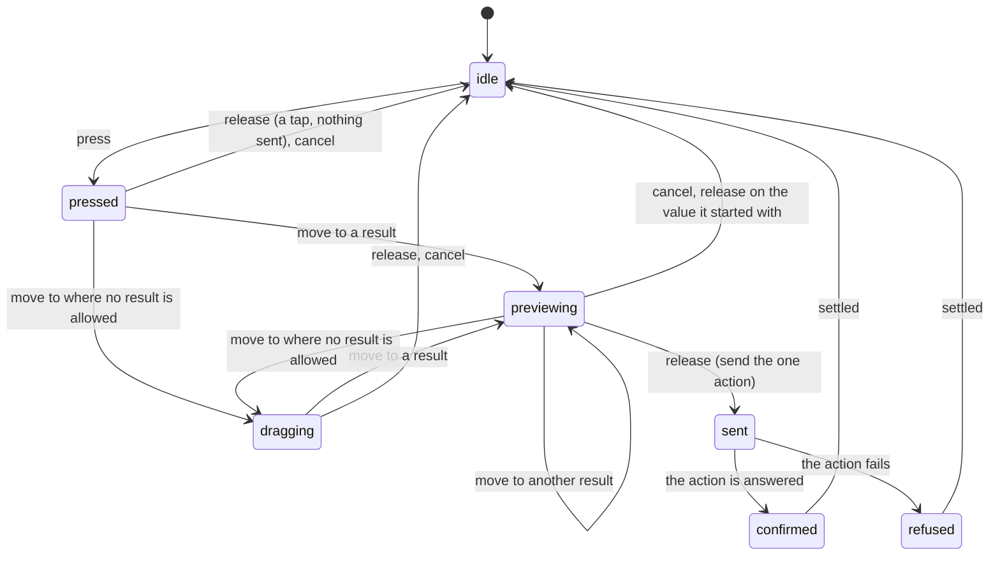
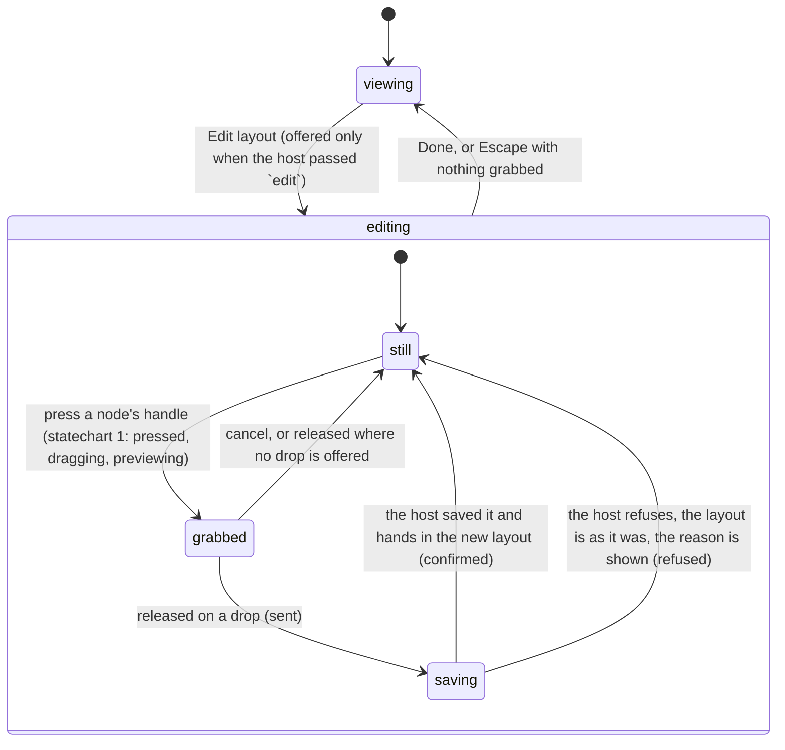

# Boundaries, statecharts, and the ways in

## Who may call whom

```text
crate   gesture (new, uses nothing) <- kind <- built <- behave <- tree          layout (alone): edit, slots, drops
web     core/gesture.ts, core/kind/<kind>.ts        no DOM (core's `document.` ban)
        gesture.ts                                  the driver: the only pointer capture in web/src
        render/<kind>.ts -> gesture.ts, core/kind/<kind>.ts
        shell.ts -> gesture.ts                      gives Ctx its `held` and `view`; runs layout's edit mode
swift   Blocks/Gesture.swift, Blocks/Kind/<Kind>+Rules.swift      Foundation only (the `import SwiftUI` ban)
        BlocksUI/Gestured.swift                     the driver: the only DragGesture for a result
        BlocksUI/<kind view> -> Gestured.swift
```

| Part | Does | May not |
|---|---|---|
| the machine | turns a phase and an event into the next phase and at most one effect | read a clock, touch the DOM, know a kind |
| a kind's rules | say which gesture a grab is, the candidate for a reach or a nudge, its words | know pixels or time, read another kind |
| the driver | listens (pointer, keys, named actions), asks the rules, steps the machine, speaks, sends through `act`, keeps `held` | fetch, name a kind, decide a result |
| a kind's view | draws the data, and a candidate when handed one; turns pixels into its reach | capture a pointer, start a timer for a gesture, send a gesture's action itself |
| the shell or the host | hands in `act`; holds `held` and `view`; for a layout, hands in `save` | change the model before the answer |
| the app | reads the result, decides, answers with ops or refuses; for a layout runs `layout::edit` and saves | |

The two bans at the end of `adr.md` hold the fourth row: a view that captures a pointer or adds a `DragGesture`
fails arch-check.

## Statechart 1: one item's gesture



There is one machine per grabbed item. A block has at most one item between `pressed` and `previewing`, since
there is one pointer and one focus, and any number in `sent`. An item in `sent` ignores press, move, release
and cancel; the others stay usable.

| Phase | The item is drawn | A screen reader hears |
|---|---|---|
| idle | from the data | |
| pressed | lifted | its name, "grabbed", the words for where it is, and the keys |
| dragging | under the pointer, faded | "no drop here" |
| previewing | at the candidate, snapped | the candidate's words |
| sent | at the candidate, dimmed, busy | "sending" |
| confirmed | from the data; if the data differs from the candidate it moves there | the words for where the data has it |
| refused | from the data again | "not changed", then the reason |

| Event | Pointer | Keys | A named action |
|---|---|---|---|
| press | down on a handle or a body | Space on the focused item | each named action is press, one move and release |
| move | the pointer is 4 px away or more: `candidate(grab, reach(dx, dy))`. A touch on a body moves it only after a 300 ms hold; sooner, the page scrolls and the gesture is cancelled | an arrow: `nudge`; with Shift, a big one | the action's own nudge |
| release | up | Enter or Space | |
| cancel | Escape, `pointercancel`, an op removes the item | Escape, or focus leaves | |
| answer | the promise `act` returns settles: `true` confirms; `false` or a rejection refuses, with its message | | |
| settled | the last transition ends, or at once when there is none | | |

Keys never give a tap: Enter on an item that is not grabbed is its own `tap`. An op that changes a grabbed item
gives the machine a new start value and the gesture goes on; an op that removes it cancels.

A confirmed gesture whose data did not change (the app opened a confirm sheet, or decided otherwise) ends like a
refused one, with no reason shown.

## Statechart 2: a layout's edit mode (#130)



In `editing`, a tap on a node does not open it. Each node shows a handle and a "shows as" picker, which sends a
`Show` edit for the size class on screen (`hidden` is one of its choices). When the size class changes, a grab is
cancelled and the picker names the other size. Each edit is saved by itself: there is no draft of several.

## What every view that takes gestures meets

1. **Three ways in, one action out.** Pointer, keys and named actions end in the same action with the same
   values. Each harness runs every fixture case once per way in and compares what was sent.
2. **Every item that can be grabbed is a focus stop with a role and a name**, and so is each of its grips
   ("Start of Tower A", "End of Tower A"). A handle is at least `--hit` wide and high.
3. **Between press and settled, only `transform` and `opacity` change** on what moves. Durations are a token
   times `--motion`. Following the pointer is not a transition.
4. **The model is not changed before the answer.** A candidate lives in `held`, outside the model, keyed by block
   and item, so a patch that redraws the block draws the item where it was dropped.
5. **View state lives in `view`, by block id**: zoom, scroll, page, selection. A redraw keeps it, and puts the
   focus back on the item with the same id.
6. **Nothing from the device**: no clock (today is the screen's `locale`), no locale, no storage but the Ctx's.
7. **Touch**: handles and grips have `touch-action: none`; a body needs the hold, so the page still scrolls.
8. **The static page draws the kind read-only**: the data, no handle, no script.

## The ways in, the motion and reduced motion, per gesture

Reduced motion means the system setting, or a look whose `--motion` is 0. In both, every row's "reduced" column
applies; what follows the pointer still does, since that is the user's own movement.

| Gesture | Pointer | Keys (after Space grabs; Enter drops, Escape cancels) | Named actions | Motion | Reduced |
|---|---|---|---|---|---|
| `reorder` (list, table rows) | drag the row's handle | Up, Down one place; Shift: to the first or last | Move up, Move down, Move to top, Move to bottom | the row follows; the others slide to make room over `--enter` | the others jump |
| `move` (timeline bar) | drag the bar | Left, Right one day; Shift: seven | One day earlier, later; One week earlier, later | the bar slides from day to day | it jumps day to day |
| `stretch` (timeline bar) | drag a grip | focus the grip; Left, Right one day; Shift: seven | Start one day earlier, later; End one day earlier, later | a ghost of the bar scales from the fixed end | the ghost jumps |
| `draw` (timeline) | tap or drag on an empty day | focus a row; Enter makes one day at the first free day, grabbed | Add a bar | the new bar fades in over `--enter` | it appears |
| `edit` (table cell) | tap the cell, type | arrows go cell to cell; Enter or a letter starts; Enter sends and goes down, Tab sends and goes right, Escape cancels | each cell is a text field named by its column and row | none: a sent cell is dimmed | the same |
| `draw` (mark) | pick a tool, drag on the image | Enter on a tool puts a mark in the middle, grabbed; arrows move it 1 %, Shift 10 % | Add arrow, Add box, and so on: one at the middle | the mark grows from its start by scale | it follows with no easing |
| `move`, `stretch` (mark) | drag the mark, or one of its ends | arrows 1 %, Shift 10 %; an end is its own focus stop | Move up, down, left, right; Longer, Shorter | translate; scale from the fixed end | no easing |
| `remove` (mark) | select it, press Delete in the toolbar | Delete or Backspace on the focused mark | Delete | fades out over `--enter` once confirmed | it goes at once |
| `move` (chart point) | drag the point up or down | Up, Down one step; Shift: ten | Raise, Lower | the point and its line segment follow | no easing |
| `Move`, `Swap` (layout node) | drag the node's handle between nodes, or onto one | arrows walk `drops` in reading order: before a node, onto it (a swap), after it | Move earlier, Move later, Swap with the next, Move to each slot by name | the node follows; the others slide over `--enter` | the others jump |
| view: zoom, pan, page | pinch, Ctrl and wheel, drag, swipe | plus, minus, 0 to fit; Page Up, Page Down; arrows scroll | Zoom in, Zoom out, Fit, Next page, Previous page as named buttons | the picture scales by transform during the pinch; its size is written once at the end | no easing |

For every row: when confirmed, an item whose data differs from where it was dropped moves there over
`--settle`; when refused, it moves back over `--settle` and the reason is in the toast and spoken. Reduced: both
are at once, and the toast and the words are what tell the user.

## View gestures

Zoom, pan, page, scroll and select change only `view`. They have no field, no phase after `previewing` and send
nothing. `zoomed` in the driver is the one pinch and wheel zoom: `pages`, a `media` with marks and the `images`
viewer use it. The core slice builds it and moves the viewer onto it, deleting the viewer's own touch code in
both renderers. A `timeline`'s day width is a view value too.
