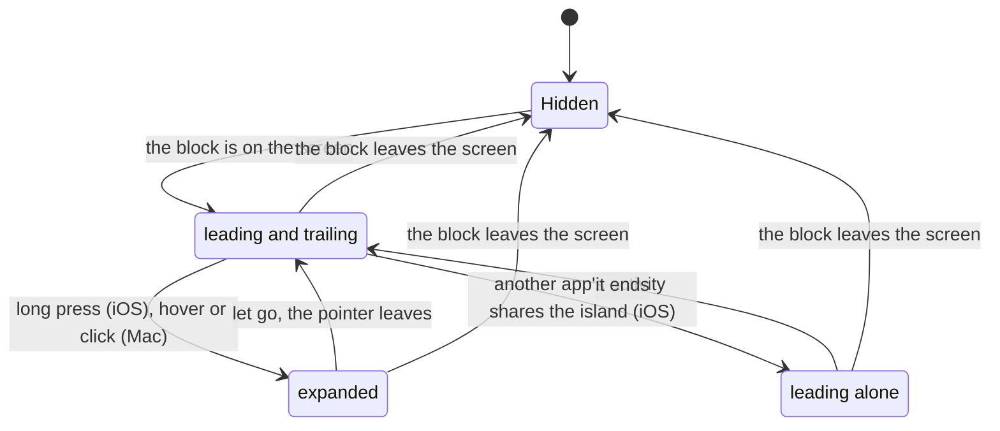
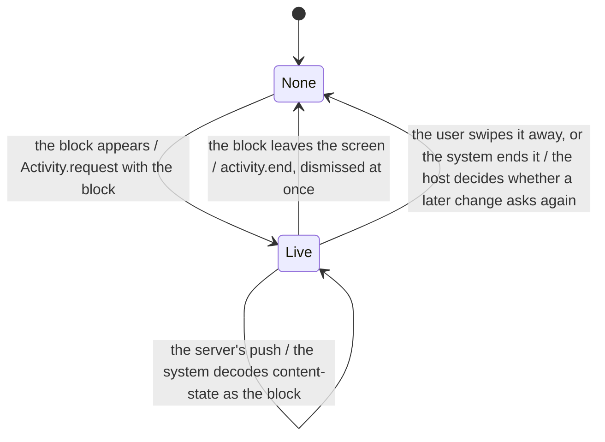

# Boundaries

## Who hands what to whom

```
a server: Glance::new(…) in a screen ──▶ Shelf, diff ──▶ the stream ──▶ the app: Replica holds the screen
                                                                              │ each change
          ┌───────────────────────────────────┬───────────────────────────────┤
          ▼                                   ▼                               ▼
 Activity.request / update            the screen's JSON in the           the notch panel's root view
 (state: the Glance block)            App Group, reloadAllTimelines      (the app's own window)
 or the server's push:                        │                               │
 content-state = the block                    ▼                               ▼
          │                           the widget extension:              GlanceView(block, .leading)
          ▼                           provider decodes the screen        GlanceView(block, .trailing)
 the widget extension:                GlanceView(block, .small)          GlanceView(block, .expanded)
 GlanceView(state, .leading)          GlanceView(block, .medium)
 GlanceView(state, .trailing)
 GlanceView(state, .expanded)
```

A tap goes back the same way on all three: a `Link` to the app's URL, or the app's intent. No form calls `act`.

## Which module may call which

| Module | May use | Never | Enforced by |
|---|---|---|---|
| `kind/core/glance.rs` | the shared parts of `kind` (`Figure`, `Shown`, `Tone`, `Tap`, `Act`) | a `Block` inside it; `wire`, `layout` | the types; the `kind` layer |
| `guard/rules/glance_heavy.rs` | `kind`, `built` | | the rule table test: a fix text and a failing fixture |
| `site/kind/glance.rs`, `web/src/render/kind/glance.ts` | the fallback writer of their renderer | a drawing of a form | review; the same-shape tree test |
| `Blocks/Kind/Glance+Rules.swift` | Foundation, the generated types | SwiftUI | the `import SwiftUI` ban on `Blocks` |
| `BlocksUI/Glance/*` | `Blocks`, the look, the finishes, `Link`, AppIntents (`GlanceTaps.swift` only) | state, a clock, `ActButton`, a ground, another kind's view, WidgetKit, ActivityKit | the six bans in `adr.md` |
| `BlocksUI/Kind/Glance.swift` | `GlanceView`, the `surface` finish | a layout of its own | review |
| `BlocksSnapshot/Form.swift`, `blocks-snap` | `BlocksUI`, `Pixels` | WidgetKit, ActivityKit | the two bans on `swift/Sources/**` |
| a host app | `Blocks`, `BlocksUI`, WidgetKit, ActivityKit, AppKit, its own intents | drawing a form's content itself | the host's own review; `docs/glance.md` |

BlocksUI gives the host no window, widget or activity type, and reads none of its identifiers.

## Statechart 1: the island, and the form on it

On iOS the system owns every arrow. On the Mac the host's panel does, with its own hover and click. BlocksUI
holds none of this state: it is asked for a form and draws it.



## Statechart 2: one glance block and its Live Activity

The host's, in about ten lines (`usage.md`, 6). The screen is the one source: the activity only follows it.



A widget has no such state: every change writes the screen and reloads the timelines, and the provider draws the
file it finds.
