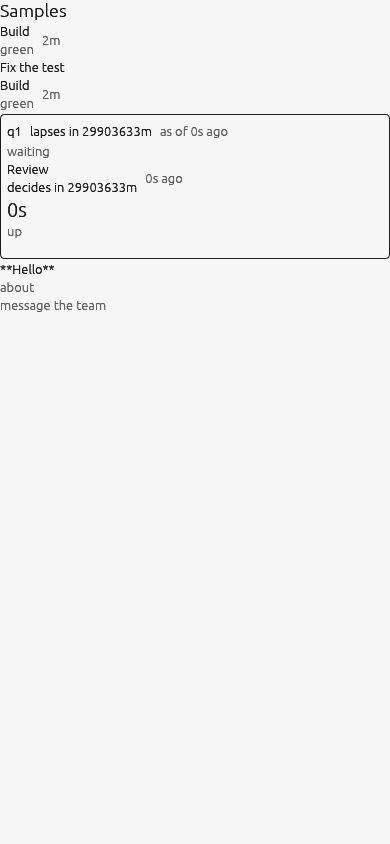
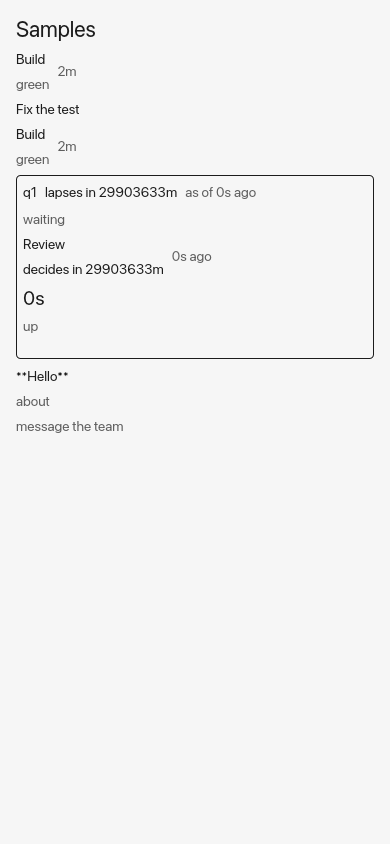
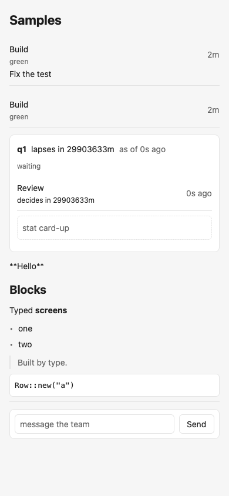

# Spike: GPUI against egui for cooee's desktop app (#299)

## Summary

Decision: egui stays. GPUI's text is the OS's own and its frames are as steady, but an app cannot pin a release of
it, it has no text field and no selectable text, `deny.toml` refuses its tree, its right-to-left is wrong on Windows,
and its harness needs a GPU driver or a real window on every runner. Not worth rewriting the renderer for.
Slices: one: land this folder and make the spike's workflow manual. No renderer change.
Open questions: keep the prototype or delete it; a follow-up issue for `blocks-desktop`'s look; whether cooee
needs right-to-left text on the desktop.

## Run the prototype

```
cargo run --release --manifest-path docs/architecture/gpui/proto/gpui/Cargo.toml -- window look
```

`look`, `rows` or `scripts`; `--scheme dark`; `--size 390x844`. The egui side is the same line with `egui` for
`gpui`. On a Mac with Xcode's Metal toolchain missing it still builds: the shaders compile when it starts.

## The pictures

The crate's samples at 390, light. Left: `blocks-desktop` today. Middle: the same, with the app setting a font, type
sizes and spacing. Right: the GPUI prototype. `look/` has 1440, dark, Linux, Windows and the Thai and right-to-left
screen.

| egui today | egui, styled by the app | GPUI |
|---|---|---|
|  |  |  |

## The numbers in one table

| | egui 0.37.0 | GPUI at `2f808b3c` |
|---|---|---|
| A frame of the 200-row screen on the CPU | 0.26 to 0.44 ms | 1.4 to 2.8 ms |
| A real window at 100 Hz, scrolling and streaming | no frame late | no frame late |
| Crates for a window app, Linux / Windows / macOS | 280 / 179 / 178 | 441 / 263 / 303 |
| The toolkit alone under `deny.toml` | passes | fails: git sources, 6 licences |
| Smallest window app, stripped, macOS | 10.1 MB | 6.0 MB |
| Smallest window app, Linux x86_64 / Windows x86_64 | 18.5 MB stripped / 13.7 MB | 23.5 MB stripped / 8.9 MB |
| Pixels in CI with no GPU and no window | every OS, the same bytes | macOS and Linux (a software Vulkan driver); not Windows |
| Builds and runs in a window on the runners | Linux X11 and Wayland, Windows, macOS | the same four, each on a software renderer |
| Newest release an app can pin | 0.37.0 | 0.2.2, 13 months and 668 commits old |
| Right-to-left text | wrong | right on macOS and Linux, wrong on Windows |
| Text field, selectable text | built in | the app writes both |
| Accessibility | AccessKit | AccessKit, in the unreleased source only |

## Read in this order

| File | What |
|---|---|
| `adr.md` | the question, the options, the decision, what follows from it, the open questions |
| `usage.md` | how cooee's app reads on each toolkit |
| `design.md` | the shapes the app holds, which module may call which, the states, and what a GPUI renderer would have been |
| `measured.md` | each of the issue's seven measures: the command, the numbers, what was not measured |
| `results/` | the raw output of `proto/measure.sh`, here and on the three CI runners |
| `look/` | the screenshots |
| `proto/` | the prototype: four crates outside every workspace, and `measure.sh` |

## What was read

- blocks at `03a0d70b`: `crates/blocks-desktop`, `crates/blocks-desk`, `docs/architecture/desktop/`,
  `docs/architecture/blocks/renderers.md` sections 6 and 7, `deny.toml`, `.drover/arch.toml`, `scripts/line-cap.sh`.
- `zed-industries/zed` at `2f808b3c`: `crates/gpui`, `gpui_platform`, `gpui_macos`, `gpui_apple`, `gpui_linux`,
  `gpui_windows`, `gpui_wgpu`, and `.github/workflows/run_tests.yml`. And `gpui` 0.2.2 as published.
