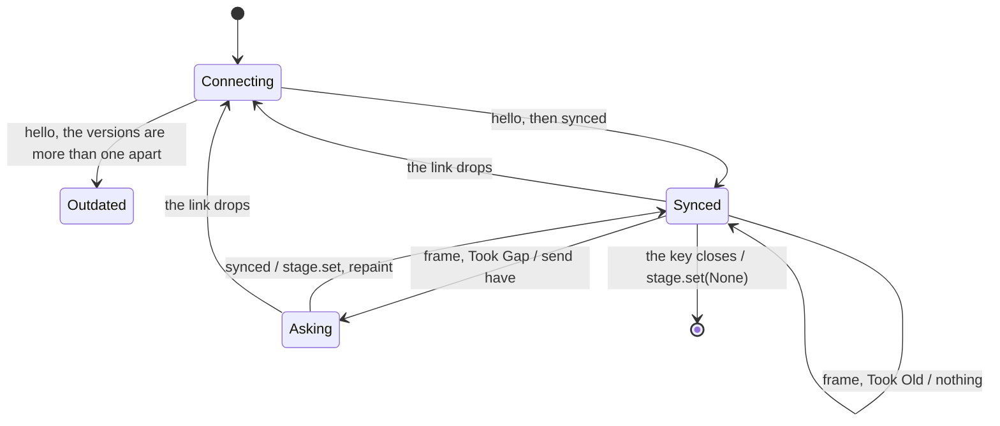

# Shapes, boundaries and states (#299)

The decision keeps egui, so nothing here is new in `crates/`. This file states what cooee's desktop app builds on,
and, in the last section, what a GPUI renderer would have been.

## Data shapes: what the app holds (all exist today)

```rust
// blocks
pub struct Mirror { .. }                      // the stream's client half: hello, frame, synced, have, screen(k)
pub enum Took { Patched, Replaced, Old, Gap } // what a frame did to its key
pub fn apply(root: &mut Block, ops: &[Op]) -> Result<(), ApplyError>;

// blocks-desktop
pub struct Stage { .. }                       // one screen on this client: the screen, its local state, the last drawn tree
impl Stage {
    pub fn set(&mut self, screen: Option<&Block>);
    pub fn show(&mut self, ui: &mut egui::Ui, kit: &Kit, unix_now: f64) -> Vec<Event>;
    pub fn drawn(&self) -> Option<&Drawn>;
}
pub struct Kit { .. }                         // the look, the art, the app's kinds, islands and wraps
pub struct Look { pub schemes: PerMode<Scheme>, pub mode: Option<Mode>, pub style: Option<Style>, pub still: bool }
pub enum Event { Act(Action), Open(String), Sheet(String), Thread(String), Refresh, Dropped(String) }
```

Cooee's app adds its own: the window (eframe), the transport that feeds `Mirror`, the clock it passes to `show`, and
the fonts and type sizes it sets on egui's `Context`.

## Module boundaries

```
cooee desktop app   eframe, winit, wgpu, the transport, the clock, files        (cooee's repo, its own lock)
      │ may call
      ▼
blocks-desktop      egui only: draws into the Ui it is handed                    (this workspace)
      │ may call
      ▼
blocks              no toolkit, no transport, no clock                           (this workspace)

blocks-desk         the headless harness: blocks-desktop on the CPU, no window  (this workspace)
demo/egui (#297)    an eframe window around blocks-desktop                      (this repo, its own lock)
docs/architecture/gpui/proto   the spike's four crates                          (this repo, four locks of their own)
```

| Rule | Enforced by |
|---|---|
| `blocks` links no toolkit | `.drover/arch.toml`'s `egui` ban; `just desktop` |
| No crate in `crates/` opens a window or links a GPU crate | `arch.toml`'s `eframe`, `winit` and `wgpu` bans; `deny.toml`'s bans |
| No crate in `crates/` comes from git or carries a licence outside the allow-list | `deny.toml`, CI `deny` |
| Nothing in `crates/`, `web/`, `swift/` or `site/` imports the prototype | it is in no workspace and no manifest names it; `arch.toml`'s layers list no path under `docs/` |

No rule changes. The prototype is deliberately outside the line cap's paths (`scripts/line-cap.sh` counts
`crates/*/src`, `site/src` and `bench/`): it is measuring equipment, not product code.

## States: a screen in the app's window



Between frames the stage has two states of its own, both inside `Stage::show`: **drawn** (the last pass drew what is
held) and **dirty** (an op, a tap's `set` or typing changed it; egui is asked for another pass). These are the same
on GPUI, where `cx.notify()` is the ask.

## If GPUI had won: what blocks-desktop would have become

Recorded so the next look at this question starts from a design, not from zero.

- **Where it lives.** Not in this workspace: `gpui` alone, with no window crate, brings 357 packages to a lock, 12 of them
  from git and 6 under licences `deny.toml` refuses (`measured.md`). A `blocks-gpui` crate would sit in its own lock, as `bench/` does, or in cooee.
  `blocks-desktop` and `blocks-desk` would be deleted once it drew the same 16 kinds.
- **The stage** becomes an entity: `Entity<Stage>` with `apply(&mut self, ops, cx)`, `EventEmitter<Event>` in place
  of the `Vec<Event>` return, and one `Entity<Field>` kept per text field. `proto/gpui/src/stage.rs` is this shape.
- **A kind** stays one file with one function, `fn(&Block, &Kind, &mut Cx) -> AnyElement`. Layout is flexbox, so the
  web renderer's CSS carries over nearly rule for rule.
- **The wrapper** sets what it sets today: `.id(..)`, `.role(..)`, `.aria_label(..)` and
  `.accessibility_id("block:<id>")`.
- **The harness** changes most. No CPU path: pixels need Metal on macOS, Vulkan (a software driver in CI) on Linux
  and a real window with Direct3D on Windows. The drawn tree with rects would be collected in the wrapper's
  `prepaint` (`on_children_prepainted`): GPUI's own bounds query, `debug_bounds`, exists in debug builds only.
- **Controls** are the cost: a text field with caret, selection, clipboard and IME; selectable prose; a scroll bar.
  egui ships all three.
