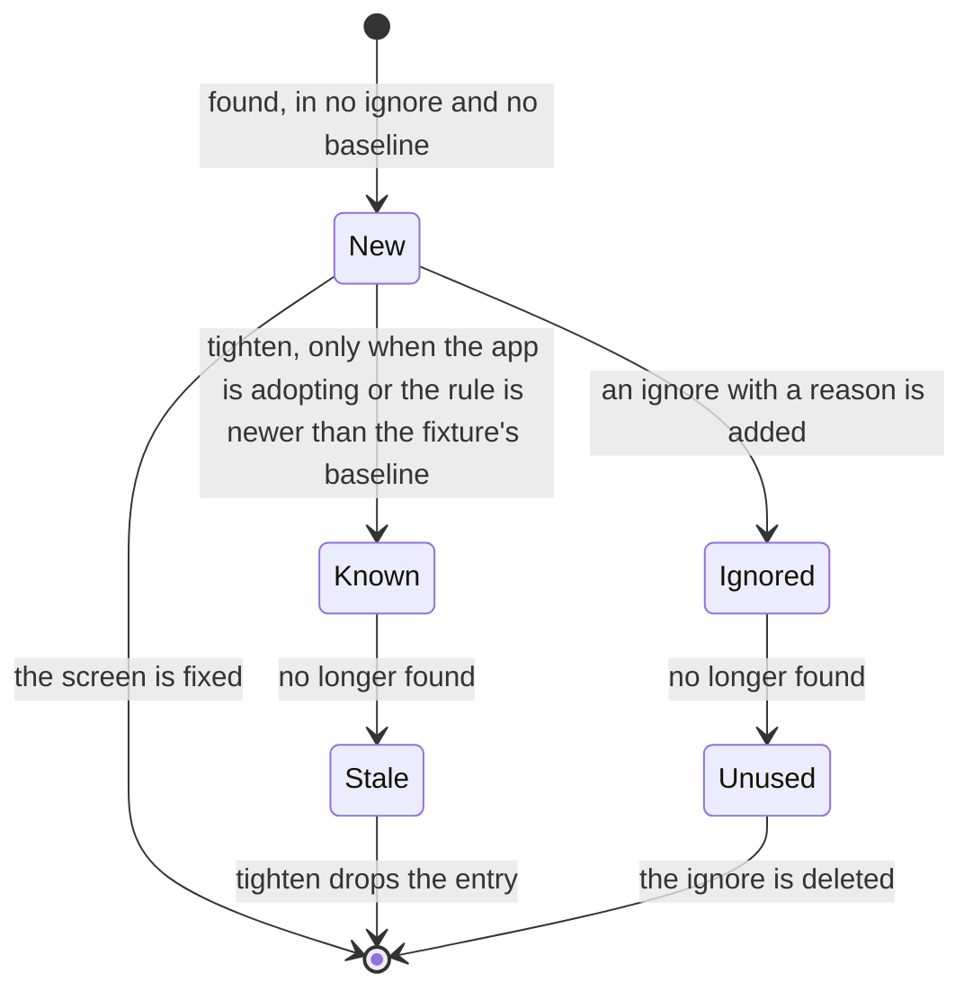
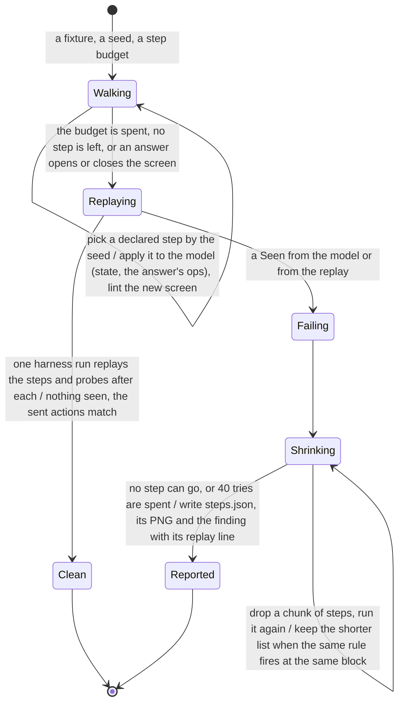

# guard: module boundaries and statecharts (#79)

## Which module may call which

| Module | Holds | May call | Never |
|---|---|---|---|
| `blocks::guard` (the crate, pure) | the shapes; the rule table, one file per rule; the static rules; `judge`, `tighten`, `sarif`; `explore`'s walk and shrinker | `expr`, `kind`, `built`, `behave`, `tree`, `wire`, `patch` | a file, a process, a clock, a harness |
| `blocks::codegen` (`codegen/`, one file per output) | `guard/rules/mod.rs` from the folder; the shapes into the schema, TS and Swift; `skill/blocks/` | every layer, `guard` included | |
| `blocks-cli` (the `blocks` bin, and `pub fn main`) | flags; reading the config, fixtures, ignores and baselines; `git diff` and `git show` for `--base`; starting the harness and the answerer; the clock for `--minutes`; printing; `skill --to`; `new kind` | `blocks::guard`, `Built`, `tree`, `wire` | a rule, a severity, a limit or a verdict of its own |
| `web/shot` (`blocks-shot`) | `--plan`; drawing; `probe/<rule>.ts`, one per `render/` and `css/` rule; `seen.json` | `web/src`: `dump`, `tree`, `gate`'s contrast ratio | fix text, severity, ignores, the baseline, the answerer |
| `BlocksSnapshot`, `blocks-snap` | the same plan; the four tree rules; a public plan runner an app's bin calls with its own views | `Blocks`, `BlocksUI` | the same |
| an app | the tool bin, `.blocks/`, its fixture writer, its answerer, its raw-UI ban | `blocks`, `blocks-cli` | |

What holds each line:

| Rule | Enforcer |
|---|---|
| `guard` uses only the layers above | arch-check, the `guard` layer |
| the library starts no process, reads no clock, writes no file | arch-check: the existing bans, with an `except` for `crates/blocks-cli/src/**` only |
| the command holds no rule | arch-check, the `cli` layer; by type: `Finding` is `#[non_exhaustive]`, so only the crate's `guard::finding` builds one |
| a harness reports no finding | by type: it writes `Seen`, which has no `fix` and no `severity` |
| every rule has a fix and a fixture that fails it | the table test in `crates/blocks/tests/guard.rs`; each `fixtures/guard/bad/<rule>.json` fires its rule and no other, each `fixtures/guard/ok/*.json` fires none |
| a rule file is listed | `guard/rules/mod.rs` is generated: arch-check fails when `just gen` would change it |
| an ignore has a reason | by type: `Reason` does not parse from an empty string |
| the skill is not hand-edited | arch-check, `generated` |
| nothing here names the apps | the existing ban on the word in `crates/*/src`, `web/src` and `swift/Sources`: the hook is described only in `docs/` |

## Chart 1: a finding through the ratchet

One finding is one `(rule, fixture, at)`. "In scope" is a changed fixture in a PR, and every fixture in the nightly
sweep.

| State, in scope | The check |
|---|---|
| `New`, an error | fails: the finding itself |
| `New`, a warning | passes: printed |
| `Known`, `Ignored` | passes: counted |
| `Stale` | fails: `guard/baseline-stale` |
| `Unused` | fails: `guard/unused-ignore` |
| `New --> Known` by any other road | fails: `guard/baseline-grew` |

So the count per fixture has one direction. A lane that fixes a finding must also drop its entry, which is one
command and is named in the finding's fix.

## Chart 2: an explore walk

- **A declared step** is one of: a tap on a block with an `id` that is drawn and enabled in the current state and
  sends an action or sets state; text typed into a field of such a block, from a fixed pool (empty, one letter, 200
  wide letters, a broken email, a good one, mixed scripts). A control with a `confirm`, and an island's events, are
  not walked in v1 and are named in `Outcome.skipped`.
- **The model decides, the renderer is checked against it.** The walk knows which `Action` each tap must send; the
  replay's `report.json` `sent` list has to equal it.
- **A tap and its answer are one unit** for the shrinker, so a shrunk list is still a valid script.
- **The seed** of a walk is the run's seed mixed with the fixture's name and the walk's number, so one failing walk
  replays alone. The nightly seed is the day number, as `sim.yml` does.
- **Time.** `--minutes` is read between walks: it stops new walks and never cuts one. The crate reads no clock.
