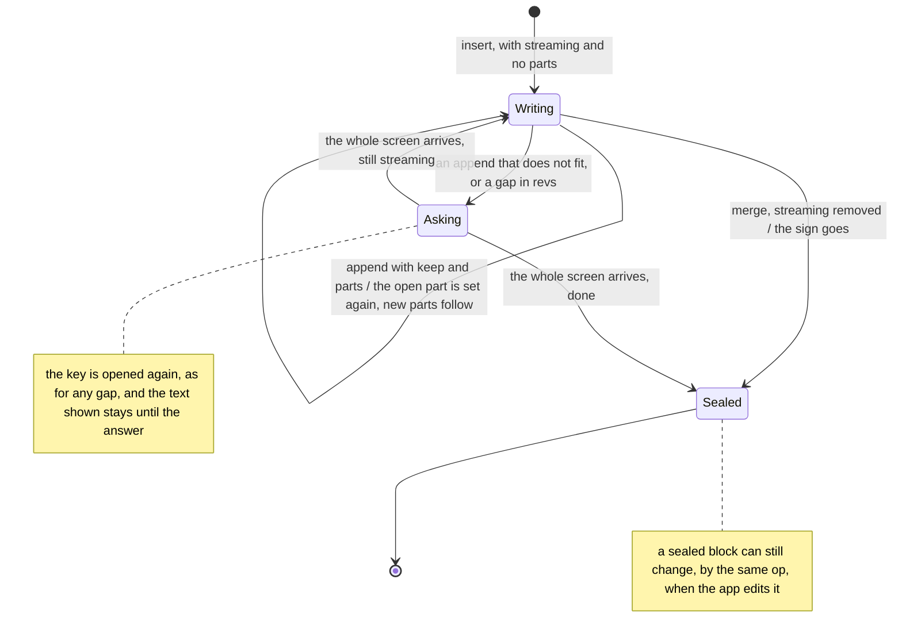
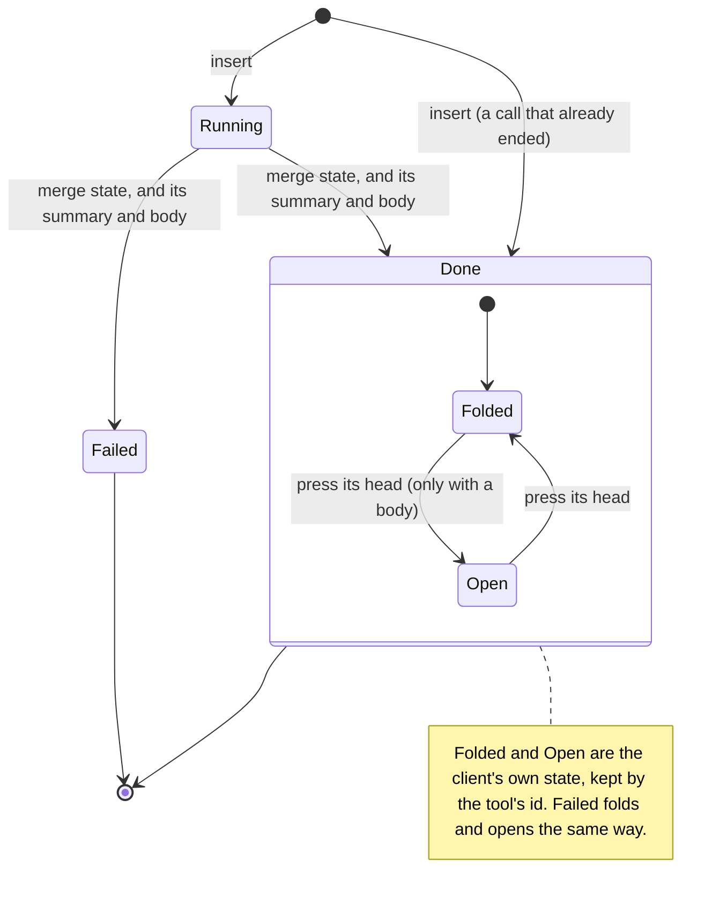
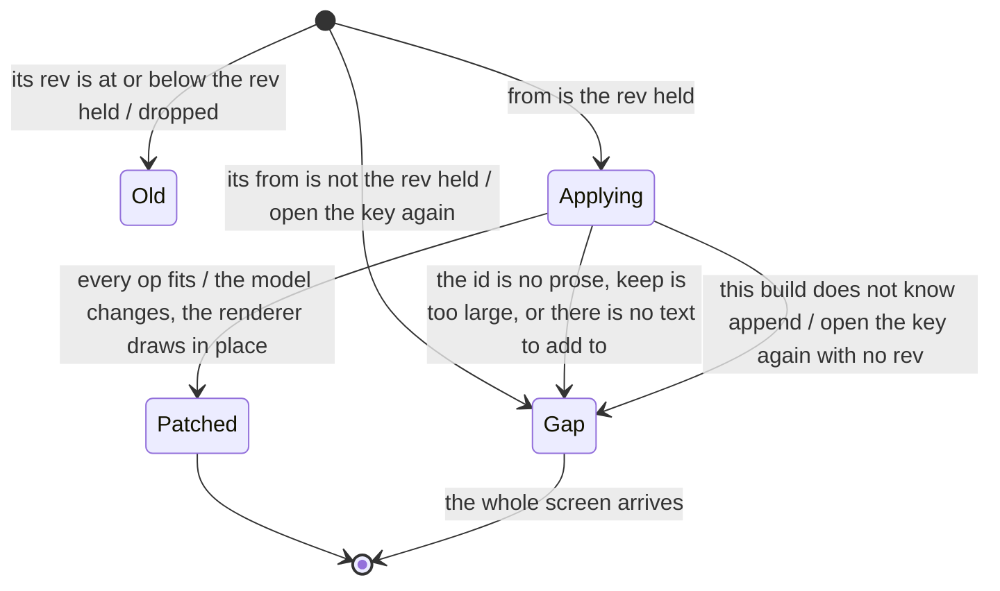

# Boundaries

## Which module may call which

```
an app ──▶ Prose::read (markdown in, parts out) ──▶ the builders ──▶ Shelf::put ──▶ diff ──▶ Op::Append ──▶ the stream
                                                                                                  │
   a renderer's prose view  ◀── the patcher / the view's own diff ◀── Mirror, Replica: apply ◀────┘
```

| Module | May use | Never | Enforced by |
|---|---|---|---|
| `kind/core/prose.rs` (`read`, `grow`), `message.rs`, `tool.rs` | `expr`, the rest of `kind` | `wire`, a clock, a file | the `kind` layer, as today |
| `wire.rs` (`Op::Append`, `old`) | `kind` (it carries `Part`) | `patch` | the `wire` layer |
| `patch.rs` | `kind`, `wire`; it calls `Prose::grow` | its own copy of the growth rule | the layer; `fixtures/append/` in three languages |
| `diff.rs` | `kind`, `wire`, `patch` | | the layer; it checks its ops with `apply`, as today |
| `guard/rules/*.rs` | as today | | the rule table test: a fix text and a failing fixture each |
| `web/src/core/apply.ts` (moved from `patch.ts`), `core/kind/prose.ts` (the growth rule) | `gen/` | the DOM, a renderer | the core's `document.` and `render/` bans |
| `web/src/patch.ts` | the DOM, a `draw` and a `grow` it is handed | the model's copy, a kind's file | its 200-line limit; the new ban (`adr.md`) |
| `web/src/render/kind/prose.ts`, `message.ts`, `tool.ts` | the core, `gen/`, the render helpers | another kind's file, markdown | the bans on `render/kind/**`, as today |
| `web/react/src/kinds/*.ts` | the core, `gen/`, `react` | the HTML renderer | #81's bans; the same-markup test |
| `swift/Sources/Blocks/Apply.swift` | `JSONValue`, the generated types | SwiftUI | the `import SwiftUI` ban |
| `BlocksUI/Kind/Message.swift`, `Tool.swift` | `BlockNode`, `BlockStack`, `ActButton`, the look | another kind's private views | as today |
| `blocks-desktop/src/draw/message.rs`, `tool.rs`, `prose.rs` | `look`, `cx` | `stage`, another kind's file | the `desktop-draw` layer |

Only `diff` writes an `append`. An app builds screens; it does not write ops by hand.

## What every renderer does

1. **A message** draws who (the name, the avatar or what stands for it, by `role`), then its blocks through the
   renderer's own block switch, then its attachments. It decides nothing about a child: a prose child is the prose
   view, an unknown child is that child's fallback.
2. **A tool** draws its name, its summary on one line and its state. With a `body` its head is a button that opens
   the body below; the open state is local, kept by the tool's id, and a later op on the tool or on its message
   does not close it.
3. **An attachment** is one control at least 44 px each way: a link for a `url`, else a button that runs the tap.
4. **A streaming prose** shows the sign after its last part and says `aria-busy`. The sign's motion follows the
   motion rules (opacity or transform, off under reduced motion).
5. **An `append` is drawn in place**, each renderer in its own way:

   | Renderer | In place means | Held by |
   |---|---|---|
   | HTML | the patcher hands the op to the prose view's `grow`: `text` goes on the last text node, `keep` and `parts` replace the part elements from `keep` on. No element before them is touched or made again. A `grow` that cannot (no element, an odd shape) redraws that one block | `web/test/kind/prose.test.ts`: the element after the ops equals a fresh draw, and its earlier children are the same nodes; the script's `longest_patch_ms` |
   | React | the next screen from `apply`; `share` and the memo per block draw only the prose again, and React keeps the parts by index | a render count of 0 for every other block |
   | SwiftUI | `Replica.frames` changes the block; SwiftUI's own diff keeps every view whose value is equal, and the parts by index | the script: the opened tool stays open |
   | egui | every pass draws from the screen it holds; `Stage::set` keeps the screen's local state, and an opened body is kept by the tool's id | the script, in the desktop harness |
   | static page | drawn once, with the sign if `streaming`; taken over by the live page with no change | `fixtures/site/`, as every kind |

6. **A `merge` on a tool** redraws that tool block alone, as a merge on a row does today. A `merge` on the message
   (its name, its files) redraws the message; its tools' open state survives because it is kept by id.

## Statechart 1: one prose block that streams



## Statechart 2: one tool row



## Statechart 3: a frame with an `append`, in a client



The last arrow into `Gap` is a client built before this op. It still ends on the right screen, at the cost of one
whole screen per frame, so an app ships its clients before its server starts to stream (`adr.md`, Consequences).
