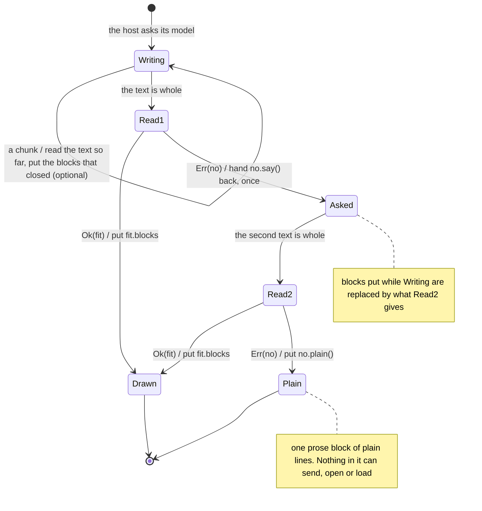
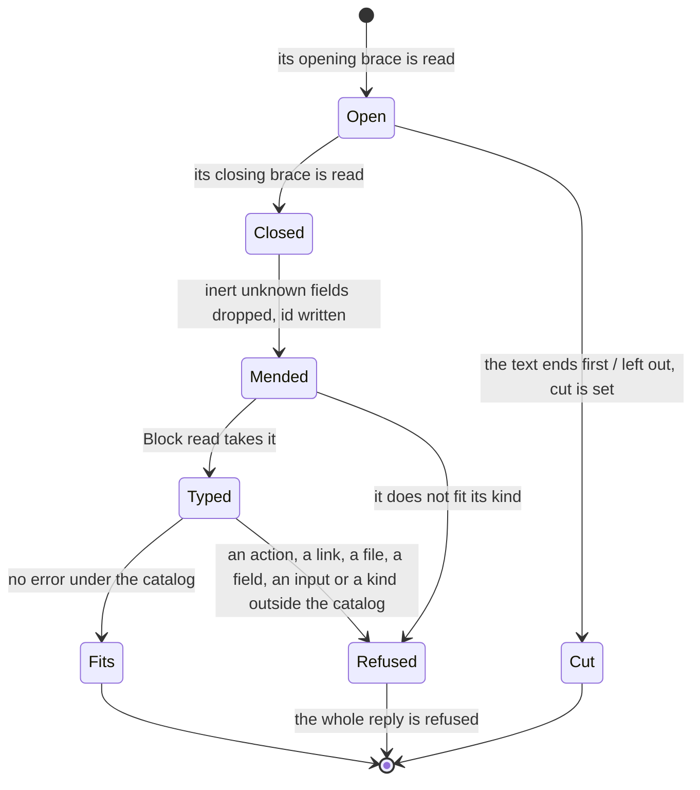

# Boundaries and statecharts (#359)

## Which module may call which

```
the host: its model call ──text──▶ model::read ──▶ Fit: Vec<Block> ──▶ the host's builders ──▶ Shelf::put ──▶ the stream
   ▲          │                        │
   │          └── model::prompt        ├── catalog   (what is allowed; the generated cards)
   │                                   ├── guard::lint_in ──▶ Built::check, the lint/ rules, the catalog/ rules
   └────── Refusal::say (once) ◀───────┘
```

| Module | Holds | May call | Never |
|---|---|---|---|
| `catalog/` (new layer) | `Catalog`, `Allow`, `Max`, `Catalog::read`; `cards.rs`, generated: each kind's and part's line and fields | `kind` | `built`, `guard`, `wire`, a file, a model |
| `guard/rules/` (eight new files) | the `catalog/` rules, one file each, in the generated table | as `guard` today, plus `catalog` | a mend: a rule only sees |
| `model/` (new layer) | `read` (find the JSON, close it, mend, type, check), `own`, `prompt`, `Fit`, `Refusal`, `score` | `kind`, `built`, `catalog`, `guard` | `wire`'s stream, `shelf`, `diff`, a clock, a file, a process, a model call |
| `codegen/cards.rs` | writes `catalog/cards.rs` from the schema, as `codegen/skill.rs` writes the skill | every layer | |
| `blocks-cli` (`prompt`, `read`, `eval`) | flags, files, starting the `--model` command, printing the table | `catalog`, `model`, `guard` | a rule, a mend or a mark of its own; a model call that is not the owner's command |
| `kind`, `built`, `wire`, `patch`, `diff`, `shelf`, `mirror`, every renderer, TS, Swift | unchanged | | `catalog`, `model` |
| a host (cooee) | the catalog file, the model call, the retry, where the blocks go, what an action does | `Catalog::read`, `model::*` | |

What holds each line:

| Rule | Enforcer |
|---|---|
| `catalog` and `model` use only the layers above; nothing below uses them | arch-check, the two new layers (`adr.md`, the `arch.toml` lines) |
| the reader calls no model and opens no socket or file | arch-check: the bans on `tokio`, `std::net`, `std::process`, `std::fs` that exist |
| a catalog is made only by `Catalog::read` | by type: `#[non_exhaustive]` with no constructor and no `Default`, as `Finding` is today |
| a mend never touches what sends, opens or loads | the reader's own comparison on every read (`read/kept`), and its test over `fixtures/model/read/` and every eval reply |
| every `catalog/` rule has a fix text and a failing fixture | the rule table test that exists, taught to judge `fixtures/guard/bad/catalog/` under the catalog beside it |
| `cards.rs` is not hand-edited | arch-check, `generated` |
| the prompt does not grow unseen | a test: the three sample catalogs within a tenth of `shapes.md`'s sizes |
| a reader change does not silently turn a fit into a refusal | CI scores each set under `fixtures/evals/replies/` against its kept summary |
| the reader is cheap enough to call per chunk | `perf.rs`: a 16,000-character reply reads within its budget, set when the slice measures it |

`.drover/rules.md` is at its 30 lines. Nothing here adds one: each rule above is a type or a test.

## What the reader does, in order

```
text ─▶ size ─▶ find ─▶ close ─▶ root ─▶ mend ─▶ type ─▶ check ─▶ Fit
         │       │                         │       │        │
     read/size   └ no JSON: read/json      │       │        └ any error of lint_in, or read/kept ─▶ Refusal
                                           │       └ Block::read fails ─▶ Refusal (lint/fault, the kind's own message)
                                           └ ids and names written; inert unknown fields dropped; markdown to parts
```

It is one pass with no state between calls. The check runs on the blocks as they will sit: inside a `message`,
inside a `screen`, so depth and count rules see what a client will draw.

## Statechart 1: one reply, in the host

The state is the host's. blocks holds none: `read` is a function of the catalog, the prefix and the text.



- There is no third try. A host that loops is a host bug; `usage.md` part 3 is the whole loop.
- `fit.cut` on a whole text means the model ran out of room. The blocks that closed are checked and good; the host
  keeps them or treats it as `Err`. That choice is the host's.
- A refusal while `Writing` is not acted on: the host waits for the whole text.

## Statechart 2: one block of a reply, in the reader



This is a top-level block. A block inside it is read only once its parent has closed, so a card never shows
without its buttons, and the one block that can be cut is the last at the top level.

## What stays the host's job

| The host | Why not blocks |
|---|---|
| the model call: provider, key, model, token limit, timeout, its own network retries | no transport and no secret here |
| whether a persona answers in text or in blocks, and how it asks: a tool call whose argument is the reply (recommended), or a JSON-only turn | cooee's persona wiring |
| the catalog's contents, and which persona or trust level gets which | only the host knows what its actions do |
| the retry: one call with `say()`, then `plain()` | the loop is three lines, and the call inside it is the host's |
| the prefix, and where the blocks sit: the message, its role, name and avatar | the host's screen |
| an action from a model-written block: `own`, `catalog.sends`, then its own check of the values and of who may do it | the values are user input through a form a model designed |
| what it tells the model about its earlier blocks, and keeping secrets out of that context | the host's history |
| logs of raw replies and refusals | a file and a clock |
| the `--model` command for evals, and the money it spends | the owner's |
