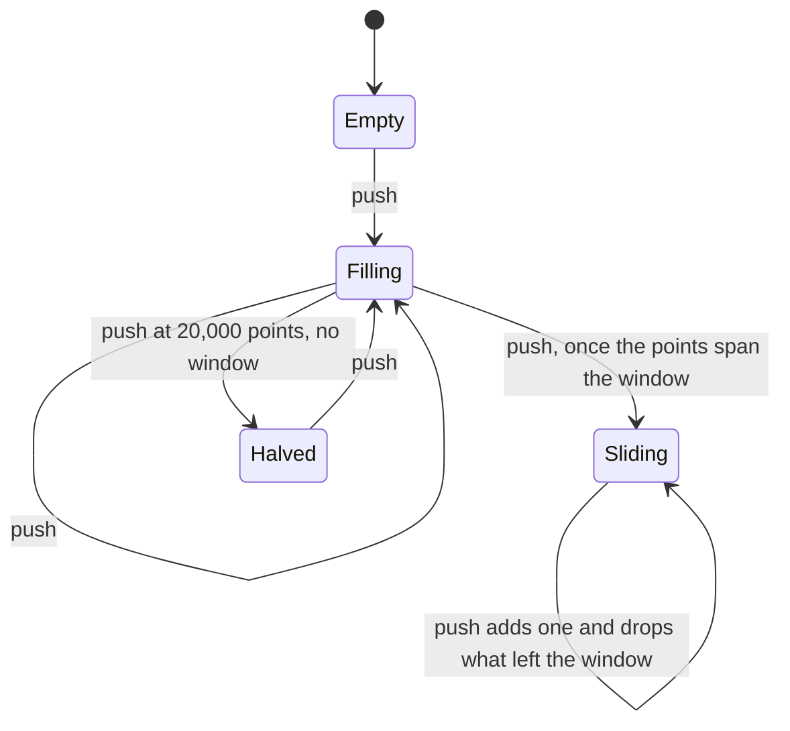
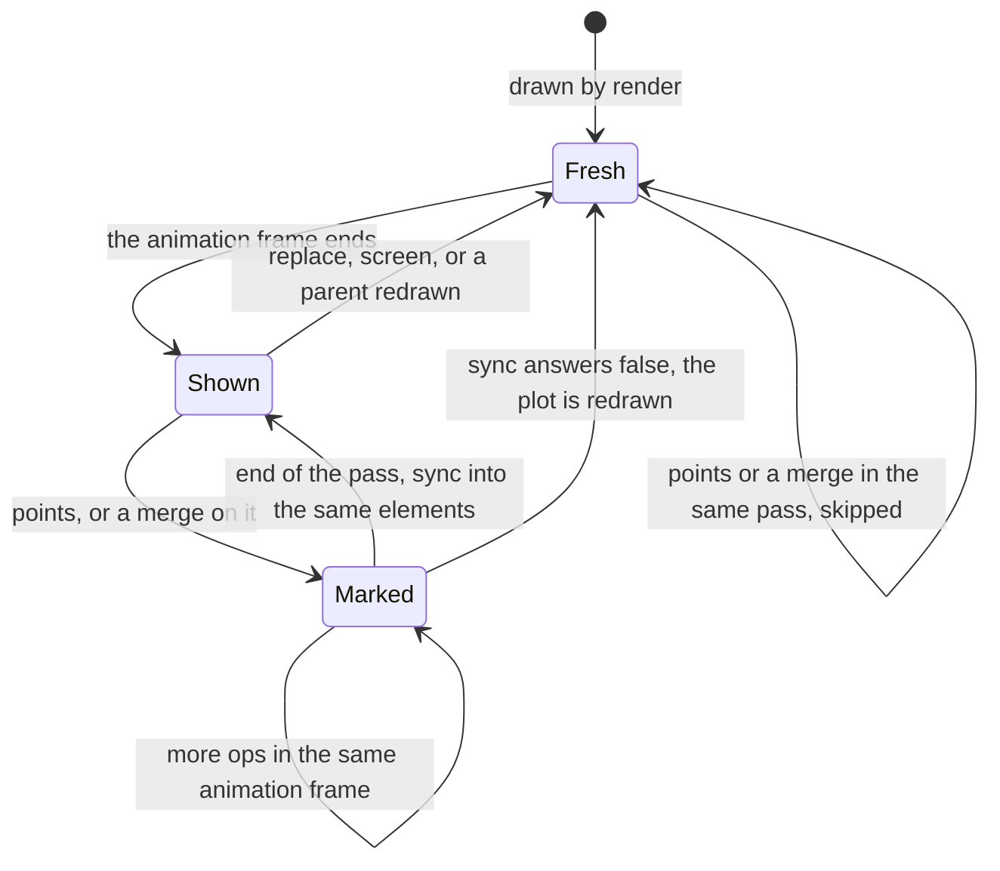
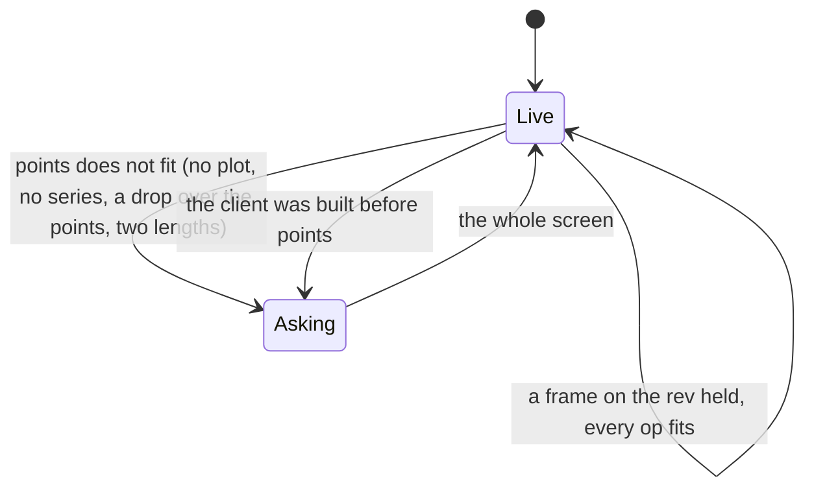

# plot: module boundaries, what each renderer does, statecharts (#351)

## Which module gains what

No layer in `.drover/arch.toml` changes. Each row stays inside what its layer may use today.

| Module | Gains | Calls |
|---|---|---|
| `kind/core/plot.rs` | `Plot`, `Trace`, `Axis`, `Target`, `Peak`; `unfit`, `grow`, `push`, `drawn` | `chart.rs`'s `nice`, shared |
| `wire.rs` | `Op::Points`; `old`'s arm | `kind` |
| `patch.rs` | `apply`'s arm | `Plot::grow` |
| `diff.rs` | `points` for a plot whose series grew | `kind`, `wire`, `patch` |
| `built.rs`, `tree.rs` | one line each: `Plot::unfit`, the `figure` role | `kind` |
| `site/kind/plot.rs` | the static marks | `Plot::drawn` |
| `shelf.rs`, `mirror.rs`, `web/src/stream.ts` | nothing | |
| `web/src/core/kind/plot.ts` | `grow`, `drawn` | the generated types |
| `web/src/core/apply.ts` | the `points` arm | `core/kind/plot.ts` |
| `web/src/render/kind/plot.ts` | `plot` (draw) and `sync` (draw into the same elements) | `core/kind/plot.ts` |
| `web/src/patch.ts` | the mark and the late draw | the table of in-place views it is handed |
| `web/src/shell/host.ts` | hands the patcher `sync: { plot }`, beside `grow` | `render/kind/plot.ts` |
| `swift/Sources/Blocks/Walk.swift` (new) | a typed walk to a block by id | the generated types |
| `swift/Sources/Blocks/Kind/Plot+Rules.swift` | `grow`, the merge that leaves the points, `drawn` | |
| `swift/Sources/Blocks/Apply.swift` | the `points` arm; `merge` tries the typed walk first | `Walk.swift`, `Plot+Rules.swift` |
| `swift/Sources/BlocksUI/Kind/Plot.swift` | the `Canvas` view | `Plot.drawn` |

Four rules, each with its check:

| Rule | Checked by |
|---|---|
| No renderer works out a range, a tick or a thinned line: it asks `drawn` | the `drawn` cases in `fixtures/plot/`, run in three languages; `site_plot.rs` and `web/test/kind/plot.test.ts`: the static writer and the live renderer write the same marks |
| A client never drops or thins points by itself | `fixtures/plot/stream.json`: three languages end on the crate's screen |
| The patcher names no kind | review; `patch.ts`'s 200-line limit keeps kind code out |
| The typed walk in Swift reaches what the JSON walk reaches | a test over every kind's sample: each block id the JSON walk finds, the typed walk finds |

## What happens to a frame that carries points

### HTML

| Stage | Runs | Does | At 4,800 points |
|---|---|---|---|
| `stream.ts` | once per animation frame | applies each stream frame that arrived to the mirror, then hands all their ops to the view once | 0.17 to 0.18 ms per stream frame; one or two arrive per animation frame |
| the patcher's pass | once per animation frame | `points`, and a `merge` on a kind with an in-place view: marks the block's id. Every other op as today. Then draws each marked block once | |
| `sync(el, plot)` | once per marked plot | from `drawn`: each line's path, the target, the peak and its label, the tick texts, in the elements that are there. It answers false when the series' names changed, and the patcher redraws | 0.47 to 0.54 ms |

A mark on a block inside an element drawn fresh in the same pass is skipped, as an `append` is today: that
element already shows the last model. Over 500 queued ops the patcher redraws the screen, as today.

### SwiftUI

| Stage | Runs | Does | At 4,800 points |
|---|---|---|---|
| `Replica.frames` | once per display frame, by the app | takes the burst in one mutation, so the view is asked to draw once | |
| `Block.apply`, `points` | per op | typed walk to the plot, then `grow` on its columns | about 1 µs, against 13.5 ms through the JSON tree |
| `Block.apply`, `merge` | per op | typed walk to the block; that block alone goes through JSON, a plot without its points, which it gets back unless the merge names `series` | not measured; no point is read |
| `Block.apply`, the rest | per batch | a lane, a round or a table row, and every other op: the JSON tree, as today | 13.5 ms |
| `PlotBlock` | when its value changed | a `Canvas` drawn from `drawn` | not measured |

### The others

The static page writes the plot once from `drawn`, with the same marks as the live renderer, so a page that goes
live adopts it as it adopts any block. React and egui draw the fallback row and ignore the points.

## Statecharts

A series on the server, under `Plot::push`:

A drawn plot in the HTML patcher:

A client's key when `points` arrives (the stream's own chart, unchanged):

