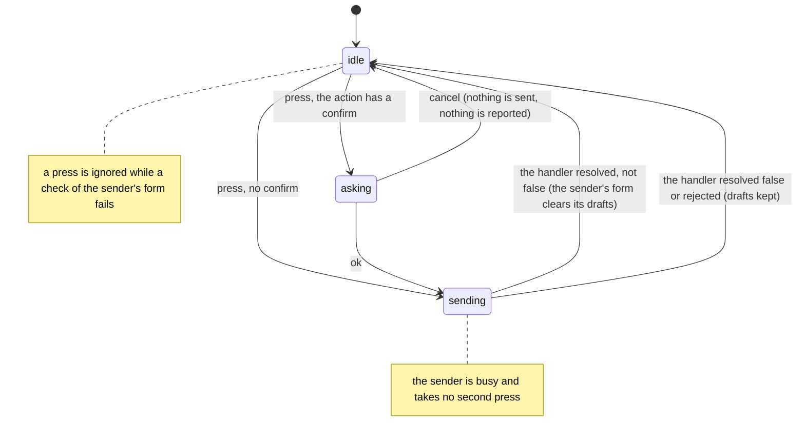
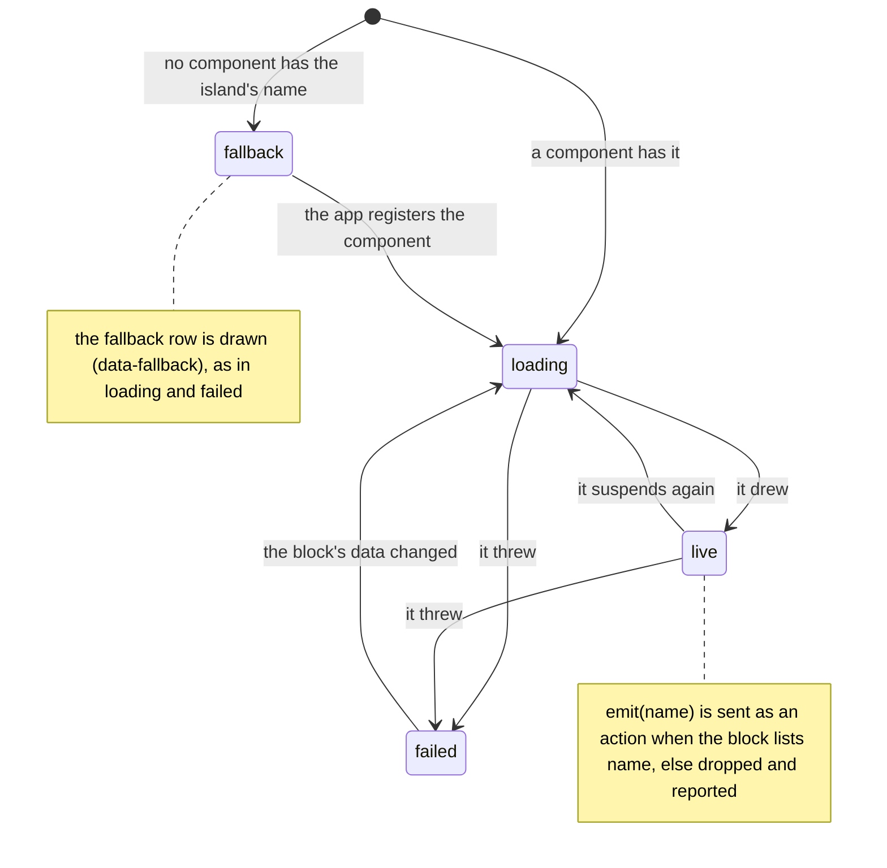

# Boundaries

## Which module may call which

```
an app (a synergy route) ───────────────┬──────────────▶ web/react  (@jirathip-dev/blocks/react)
                                        │                    │ react only
                                        ▼                    ▼
web/src/render, shell.ts, stream.ts ──▶ web/src/core  ◀── web/shot (the harness) ──▶ one adapter's boot
(Mode A: the HTML renderer)             web/src/gen
```

| Module | May import | Never | Enforced by |
|---|---|---|---|
| `web/src/core/**` | `web/src/gen/**` | the DOM, React, a renderer, the stream | arch-check bans (`document.`, `render/`, `from "react`); the core's tests run in node with no DOM |
| `web/src/render/**`, `shell.ts`, `patch.ts`, `stream.ts` | the core, `gen/` | React | the `from "react` ban; the bans already there |
| `web/react/src/**` | the core, `gen/`, `react` | the HTML renderer, `react-dom`, a router or query library, raw HTML | arch-check bans (`/render/`, `react-dom`, `@tanstack`, `dangerouslySetInnerHTML`) |
| `web/shot/**` | the core, `patch.ts`'s `apply`, a boot | | `shot/react.ts` is the one file there that imports React |
| an app | the core and the adapter, by package path | `web/src/**` by file path | the package's `exports` lists three paths only |
| the crate's `codegen/` | every layer, as today | | the existing layer rule, on the new folder path |

`web/lint.mjs` and strict `tsc` run on `web/react/src` as they do on `web/src`: no `any`, no cast, no default export.

## The adapter contract

An adapter is a renderer for one framework. It provides:

1. **A view**: draws a `Built` screen and draws it again when handed the next one. It calls `share(prev, next)`
   first, so a block whose data did not change is the same object and is not drawn again.
2. **The hooks**: every block's root and parts carry the classes and attributes in `shapes.md`. They are how
   `blocks.css` styles it, how the harness reads it and how an app's e2e test selects it.
3. **The draw rule**: its own view for a kind it draws; else the app's view for an app kind; else the fallback row
   and then the block's children. A view that throws is replaced by that block's fallback, and the rest stays.
4. **Actions**: every action leaves through one callback as the wire's `Action`. A pending action makes its
   sender busy. A confirm is asked first, and cancel sends nothing. An action whose form fails a check cannot be sent.
5. **Behaviours from the core**: local state starts from `start()`, and what is hidden, disabled and said comes
   from `view()`. An adapter has no evaluator of its own.
6. **Islands**: mounted by name, props in, `emit` out, only listed events sent, the fallback when there is no
   component, while it loads and after it fails. The box clips to the block's `size`.
7. **App kinds**: a map from kind name to view; a core kind's name is refused by type.
8. **A boot** for the harness (`shapes.md`), and **a kinds folder**, from which `just gen` writes its list of
   native kinds and its `fixtures/trees/<adapter>/`.

It passes, in CI (`react.yml` for React):

| Fixture | Through | Holds |
|---|---|---|
| `fixtures/trees/<adapter>/<kind>.json`, all 27 | `blocks-shot --adapter <a> --check` | the drawn tree: kind, id, native or fallback or hidden; every block has a size, none overlaps or leaves the width |
| `fixtures/ids/*.json` | the same | the block and action ids drawn |
| `fixtures/behave/view.json` | the harness's typing and tap steps | hidden, disabled and each check's message, drawn |
| the island cases (props arrive, a listed event is sent, an unlisted one dropped, no component, a component that throws) | the harness | part 6 |
| the tap and submit scripts on `button.json` and `form.json` | the harness's report | the same `Action` the HTML renderer sends |
| every `fixtures/blocks/<kind>.json` of a kind it draws natively | a same-markup test against the HTML renderer on one page | each element's tag, classes, `data-*`, `role`, `aria-*` and own text, in order |

The same-markup test has no stored file: the HTML renderer is the reference. An adapter may differ only where it
says so in a list the test reads (React's starts with two entries: an island's box is a `div`, and a form sends
without a field named `text`).

## Statechart 1: one action, from press to settled



There is no failed state to leave: what the user sees after a failure is the app's, drawn by its handler. A
rejection is also reported (`onReport`).

## Statechart 2: one island's box



The box and the component's own state survive a new screen as long as the island's id stays.
