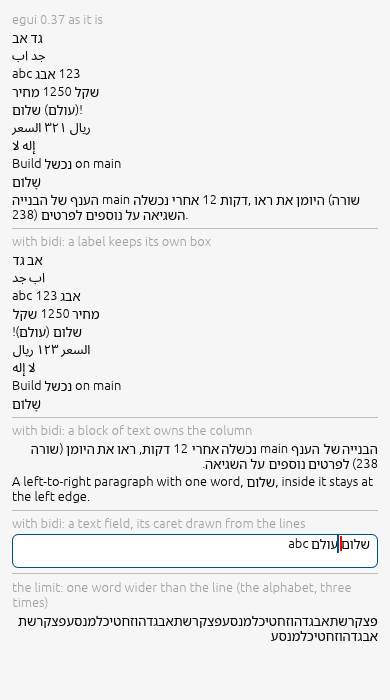

# Right-to-left and mixed-direction text in `blocks-desktop` (#304)

## Summary

Decision: egui stays, and `blocks-desktop` puts text in order itself. A new `bidi` module cuts any text that has a
right-to-left character into runs by the Unicode bidi algorithm (the `unicode-bidi` crate), lets egui shape and wrap
them, then moves each row's runs into visual order; a right-to-left paragraph sits at the right edge, and a text field
draws its own caret. Text with no such character takes egui's path untouched. A prototype draws it right.
Slices: three in one PR, about 650 lines: the module and the probe test; every text through it, with snapshots; fields.
Open questions: `unicode-bidi` as a new dependency; the cap (with #296's lines the total passes 43,000 by about 260).

## The picture

`look/noto-390.png`, drawn by the prototype with `blocks-desk`'s rasteriser at 390, Noto fonts as fallbacks. Top:
egui 0.37 as it is. Then the same texts through the prototype: labels, a block of text, a text field with its caret,
and the one drawing limit.

`look/one-font-390.png` is the same with one font that has every script (Arial first). There egui draws a number
inside Hebrew as `0521` and `main` as `niam`; with `bidi` the picture is the same as above.

## The numbers in one table

| | egui 0.37 as it is | With the prototype's `bidi` |
|---|---|---|
| Hebrew `אב גד`, x of each letter in reading order | 7, 0, 25, 18: **wrong** | 22, 15, 7, 0: right to left |
| Arabic `اب جد` | 13, 0, 26, 19: **wrong** | 30, 17, 7, 0: right to left |
| `מחיר 1250 שקל` with one font for every script | the number is drawn `0521` | `1250`, in its place |
| Glyphs egui lists for the 5 characters of `אב גד` | 7 to 9, so carets and selection miss | 5 |
| Nine samples against the Unicode algorithm's own order, three font set-ups | | the same, all 27 |
| A Hebrew paragraph wrapped at 390, 200 and 120 | words out of order on every row | every row in order, at the right edge, on whole pixels |
| Latin text | | not touched: egui's own galley |
| Left arrow in a field holding `שלום` | | the caret moves left |
| The caret at the end of `אבג` | at the right edge, x 300 | at the left of the last letter, x 280 |
| A press in a right-to-left row | index 9, 0, 0 for three places | 0, 3, 6 |
| Laying out a row title | 0.2 µs, cached | 3 to 5 µs with nothing kept; kept, two hashes |

## Read in this order

| File | What |
|---|---|
| `adr.md` | the question, what was found in egui, the options, the decision in nine parts, the written limits, the consequences, the two open questions, the exact `Cargo.toml`, `docs/deps.md`, `arch.toml` and rules lines |
| `usage.md` | how the callers read: a kind's file, a text field, an app's own kind, the tests, the harness |
| `design.md` | the data shapes, which module may call which and what enforces it, two statecharts, the four commits and what each proves |
| `measured.md` | every command and number, and what was not measured |
| `proto/` | the prototype: a crate outside every workspace, thrown away after the issue |

## What was read

- blocks `staging` at `b4f3d29`: `crates/blocks-desktop/src/` (every `draw/` file, `text.rs`, `look.rs`, `art.rs`,
  `fallback.rs`, `island.rs`, `act.rs`, `cx.rs`), `crates/blocks-desk/` (`lib.rs`, `main.rs`, `raster.rs`, the tests
  and the Thai sample), `.drover/arch.toml`, `deny.toml`, `docs/deps.md`, `scripts/line-cap.sh`, `scripts/deps-gate.sh`,
  `.github/workflows/desktop.yml`; `docs/architecture/gpui/` (`adr.md`, `measured.md`, the probe) as merged in `2be71b3`.
- The sources of `epaint` 0.37.0 (`text/text_layout.rs`, `text_layout_types.rs`, `galley_cache.rs`, `fonts.rs`), egui
  0.37.0 (`widgets/label.rs`, `widgets/text_edit/builder.rs`, `text_selection/`, `widget_text.rs`, `layers.rs`),
  harfrust 0.12.0 (`guess_segment_properties`) and `unicode-bidi` 0.3.18.
- `docs/architecture/message/` on `issue-296`, for the kinds that will draw text next (message, tool, native prose).
