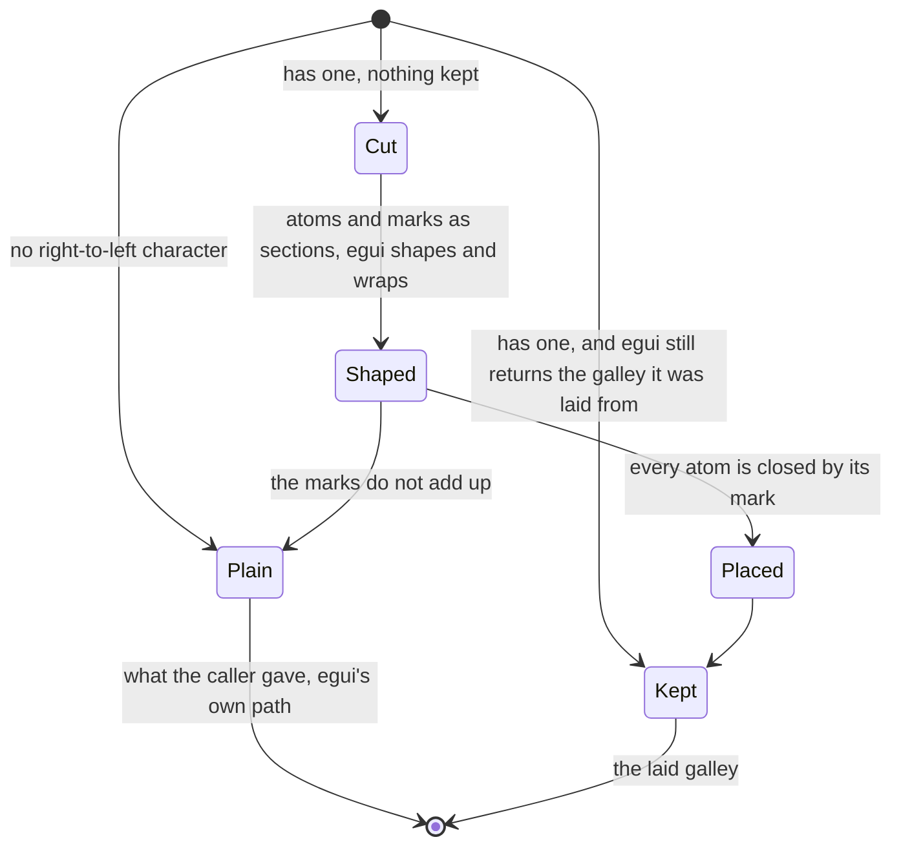
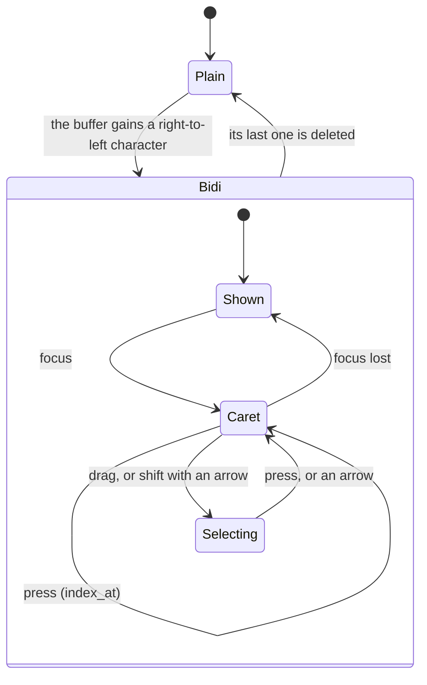

# Design: the shapes, the boundaries, the states, the slices (#304)

`proto/src/bidi.rs` is a working sketch of sections 1 and 3 (465 lines, no lints). It is thrown away; the names below
are the ones to build.

## 1. Shapes

```rust
/// The box a text is set in: a label's own width, or the column a block of text owns.
pub enum Fit { Own, Column }

/// A text laid out with every row in visual order.
pub struct Laid {
    /// Drawn in visual order. `rows[r].glyphs` is one glyph per character, in logical order, each at its visual
    /// place. `job` is the caller's job, so `text()` is the logical text.
    pub galley: Arc<Galley>,
    lines: Vec<Line>,
}

/// One row: its paragraph's direction, where it starts in the galley, and a cell per character.
struct Line { rtl: bool, x: f32, width: f32, cells: Vec<Cell> }

/// One character: where its glyph is, and which way it reads.
struct Cell { x: f32, width: f32, rtl: bool }

impl Laid {
    /// Where the caret before character `index` is drawn.
    pub fn caret(&self, index: usize) -> Rect;
    /// The caret index nearest a point in the galley.
    pub fn index_at(&self, at: Vec2) -> usize;
    /// The boxes a selection covers: one per visual run, so a mixed row may have several.
    pub fn spans(&self, chars: Range<usize>) -> Vec<Rect>;
    /// Whether the character before the caret reads right to left: the arrows swap while it does.
    pub fn rtl_at(&self, index: usize) -> bool;
}
```

Inside the module:

```rust
/// A stretch of the text egui shapes as one section.
struct Atom { bytes: Range<usize>, level: Level, kind: Kind }

enum Kind {
    /// A left-to-right run, spaces included: one glyph per character, in order.
    Ltr,
    /// Right-to-left letters of one script with their marks and joiners: egui shapes it right to left.
    Word(Script),
    /// One character alone: a neutral inside a right-to-left run (mirrored if it is a bracket), or a digit or
    /// number sign whose script is Arabic but which reads left to right (`۱۲۳`).
    One,
    Newline,
}

enum Script { Hebrew, Arabic }   // by the letter's class, R or AL: a word is cut where it changes

/// An atom's part on one row, found between two marks.
struct Piece { atom: usize, glyphs: Range<usize>, verts: Range<usize>, x: f32, width: f32, level: Level, whole: bool }

/// What is kept for a job: valid while egui still returns `from` for `shaped`.
struct Kept { shaped: LayoutJob, from: Arc<Galley>, laid: Arc<Laid> }
```

Rules the shapes carry:

- **The caret** before character `i` sits at the trailing edge of character `i - 1` (its left edge if it reads right to
  left, else its right); at a row's start, at the leading edge of the first character; in an empty row, at the
  paragraph's start edge.
- **A cell in a right-to-left word** comes from egui's glyphs: each shaped glyph names the first character of its
  cluster, and clusters run backwards. If they cannot be matched the word's width is spread evenly over its
  characters; only caret places inside that word are approximate, never the drawing. The prototype matched every
  word it was given, with marks, ligatures and joiners.
- **Moves are whole physical pixels** (`round(dx * pixels_per_point)`), so a glyph's bitmap lands as egui drew it.
- **Alignment** follows the job's `halign`: `LEFT` means start, so a right-to-left paragraph's row starts at
  `width - row width`; centre and right are egui's. `width` is the job's wrap width for `Fit::Column`, else the widest
  row. Each row follows its own paragraph, so a text with a newline may have both.

## 2. Boundaries

| Module | May call | May not | Enforced by |
|---|---|---|---|
| `bidi.rs` (`label`, `para`, `text`, `edit`, `area`, `lay`, `faults`, the kept map) | egui, `bidi/*` | `look`, `cx`, `stage`, the `blocks` crate | the new `desktop-bidi` layer |
| `bidi/atoms.rs` (read, cut, the job egui shapes) | `unicode_bidi`, egui's text types | a `Ui`, a `Context` | the layer; the `unicode_bidi` ban everywhere else |
| `bidi/place.rs` (rows into visual order, the glyphs, the lines) | `unicode_bidi`, egui's text types | a `Ui`, a `Context` | the same |
| `bidi/edit.rs` (the two modes, the caret, the arrows, the pointer) | egui, `Laid` | a kind, `look`, `cx` | the same |
| `draw/**`, `fallback.rs`, `art.rs`, `island.rs`, `stage.rs` | `bidi::label`, `para`, `text`, `edit`, `area` | `ui.label(`, `ui.heading(`, `TextEdit::` | the three bans |
| `blocks-desk` | `blocks_desktop::bidi::faults` on a pass's shapes; `lay` in its tests | `unicode_bidi` | the `unicode_bidi` ban |
| the `blocks` crate, `blocks-cli` | nothing here | `unicode_bidi` | the `unicode_bidi` ban |

`atoms` and `place` are pure: a job in, a job or a galley out. That is what the unit tests drive.

`faults` reads a pass's painted shapes. For each text with a right-to-left character it checks the outcome, not the
caller: every row has one glyph per character, and the characters sorted by x are the order UAX 9 gives. egui's own
galley fails both. The harness keeps the last pass's faults per shot and `Run::check` reports them.

## 3. States

A text, each pass:



"The marks do not add up" cannot happen with egui 0.37 as measured; it is the guard for an egui upgrade. The text is
then drawn as egui draws it today, and `faults` and the probe test say so.

A text field:



- `Plain` is `TextEdit` exactly as today: no layouter, no visuals changed.
- In `Bidi` the field passes a layouter that calls `lay`; sets egui's caret stroke to none and its selection fill to
  transparent for this field only; swaps `ArrowLeft` and `ArrowRight` in the pass's events before `show` and back
  after; after `show`, on a press or a drag, writes the caret from `index_at` into the field's `TextEditState`; then
  paints the selection (`spans`, the scheme's selection colour, translucent, over the text) and the caret (`caret`).
- The mode is read from the buffer before `show`, so a field changes mode on the pass after the character arrives.

## 4. Slices

One issue, one PR: a baseline commit, then the three slices, in this order. Line counts are non-test lines.

| | Commit | What | Proves | Lines |
|---|---|---|---|---|
| 0 | baseline | `crates/blocks-desk/tests/scripts/`: a screen with a Latin, a Thai and a CJK text, a row and a field; its 390 PNGs in light and dark as staging draws them; the test that compares bytes. `Desk::font` and `--font` take several fonts | AC 3: these files do not change again in the PR | +15 |
| 1 | `bidi` | the dependency and its lines in `docs/deps.md` and `arch.toml`; `bidi.rs`, `bidi/atoms.rs`, `bidi/place.rs`, the kept map; the two fonts with their OFL text | AC 1: `tests/rtl.rs`, the probe strings with x falling in reading order, with the fonts and with none; every sample's drawn order equals UAX 9's; wrapping at 390, 200 and 120; `lay` is none for Latin, Thai and CJK | +360 |
| 2 | every text | each `ui.label`, `ui.heading`, button, chip, hint and tooltip through `bidi`; the bans; `faults` and the harness's fault; `tests/rtl/screen.json` with every native kind that shows text, and its 390 PNGs in light and dark; the rules line | AC 2: the snapshot test on three OSes; the sample covers `kinds()`; `--check` faults a text drawn without `bidi`; a right-to-left case in `tests/perf.rs` | +120 |
| 3 | fields | `bidi/edit.rs`; the form's and the choice's fields through `bidi::edit` | AC 4: `crates/blocks-desktop/tests/edit.rs` drives a `Context` with real key and pointer events, as the prototype's `keys` does: arrows, typing, end, backspace, a press | +160 |

Notes for the lane:

- **Push sections, never `append`.** `LayoutJob::append` merges sections of one format, and a merged line is shaped
  as one run (`adr.md`, fact 3).
- **A laid label is not selectable** (`Label::selectable(false)`): the written limit. A plain one is as today.
- **The mark is U+2060.** A text that already holds one has it swapped for U+2063 in the job egui shapes; the
  caller's job, which the galley gets back, is untouched.
- **CJK has no font in the harness** (the smallest OFL one is megabytes). The baseline draws it as egui's missing
  glyph boxes, which still pins the path; the `lay` is none test is the proof.
- **The snapshots are 390 wide and as tall as the sample**, not 844: the harness's PNGs are not compressed.
- **Kept galleys:** ask egui for the shaped job's galley every pass (a cache hit) and reuse `laid` only if
  `Arc::ptr_eq` with `from`. That also keeps egui's own entry alive.
