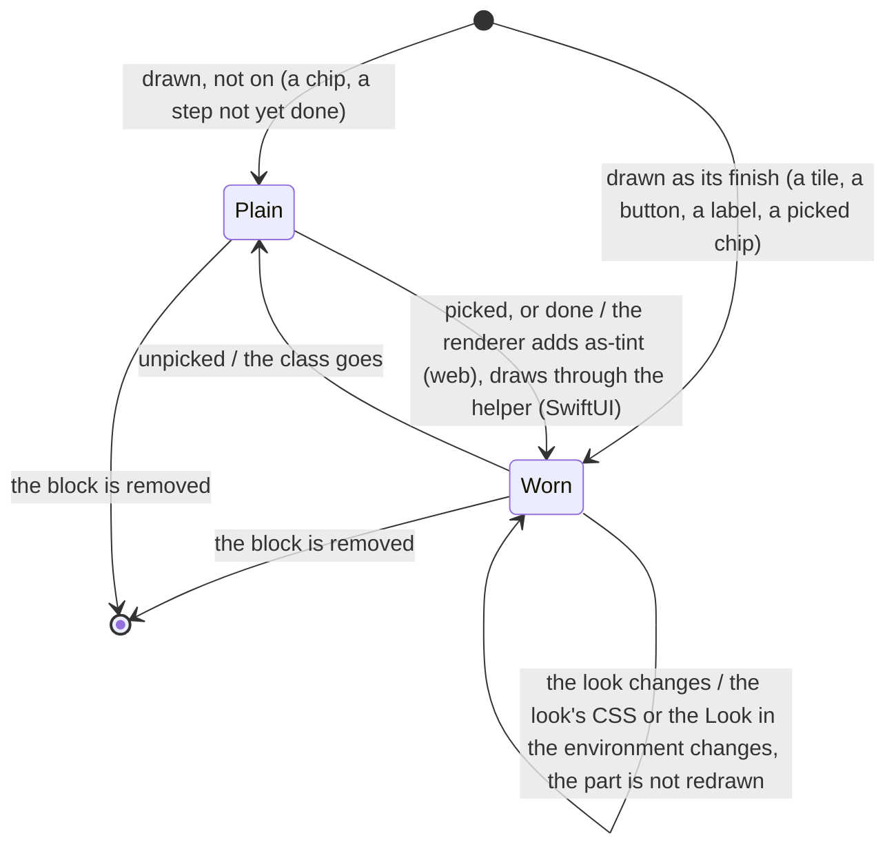
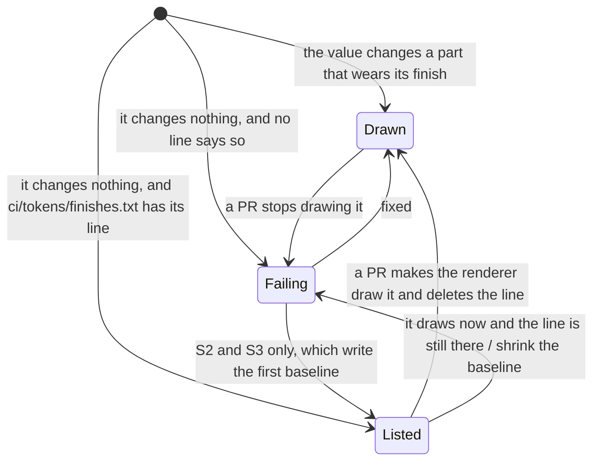

# style hooks: who may call whom (#392)

## 1. The modules

```
style.json ─▶ theme::Style ─▶ theme::axis (rows on a Finish) ─▶ theme::css ─▶ the look's CSS ─┐
                                   │                                                          ▼
                                   └─ just gen ─▶ gen/schemes.ts ─▶ core/look.ts css() ─▶ .as-<finish> in the page
                                                                                              ▲
site/kind/<kind>.rs, render/kind/<kind>.ts, react/src/kinds/<kind>.ts ── write the class ─────┘

Blocks.Style ─▶ BlocksUI/Finish/<Finish>.swift ◀── called by ── BlocksUI/Kind/<Kind>.swift
```

| Module | May use | May not | Enforced by |
|---|---|---|---|
| `theme/finish.rs`, `theme/axis/**` | nothing outside `theme` | a kind, the site, a class name of a kind | the `theme` layer in `.drover/arch.toml` (it stands alone); `Rule` has no selector field |
| `theme/css.rs` | `AXES`, `Finish::selector` | its own list of axes | `theme_finish.rs`: every rule in `fixtures/css` selects a token root or a finish |
| `site/kind/**` | `theme` (as today), to write a finish's class | deciding what a look does | the `site` layer; `just gen` fails on an `as-` class that is no finish |
| `codegen/**` | `theme`, `site` | | the `codegen` layer; `generated` holds `axis/mod.rs` and `worn.json` |
| `web/src/render/**`, `web/react/src/**` | the class names | `gen/schemes` (the rules) | the new `[[ban]]`; same-markup tests against `fixtures/html` |
| `web/src/core/look.ts` | `gen/schemes.ts` | a renderer (`render/` is banned in `core/` already) | the existing ban |
| `web/src/css/kind/**` | tokens; its own private classes | a finish's declarations on a tagged part; from S5, the tile's three declarations | S2's PNG run; S5's `[[ban]]` |
| `web/src/css/look/<finish>.css` | its finish's class, tokens | another finish's look | `web/lint.mjs`: an `as-` class anywhere in `web/src/css` is a generated finish |
| `BlocksUI/Finish/**` | `look.style`, `look.tiles`, `look.palette`, `Worn` | a kind's types | the `[[ban]]` on `look.style` everywhere else |
| `BlocksUI/Kind/**`, `Field/**`, `Part/**`, the rest | the helpers in `Finish/`, the tokens in `Look+Style.swift` | `look.style`; the six deleted accessors | the `[[ban]]`; the compiler |
| `web/shot`, `BlocksSnapshot` | the DOM, `Worn` | judging a look by a class name: they compare pixels | the look check's forced-defect tests |
| an app's CSS | `.b-` hooks, `.as-<finish>`, `[data-variant]`, `[data-tone]` | any other `.b-` or `.as-` class | guard `css/private-selector` |

A finish helper never asks which kind called it, and a kind never asks which look is on. That is the whole boundary.

## 2. A part and its finish

A part wears a finish while it shows it. Most never change; a tint comes and goes with the part's state.



- The look never changes which parts wear a finish; the part's own state does. So a new look cannot reach a part
  no kind tagged, and a patch never has to know the look.
- `worn.json` and the parity check compare the set per kind over all its fixtures, so a fixture with no picked chip
  does not fail it: `fixtures/blocks/<kind>.json` must show each finish once, as it must show each part.

## 3. A style value on one renderer

What the look check's new fact and the baseline do with each pair of a renderer and a value (`surface: dashed` on
`swift`). The same chart holds for a `kind` line, with "tags the part" for "changes a part".



- "Changes" is measured, not read from code: the harness draws one `fixtures/blocks` file that wears the finish
  (`worn.json` names it) under the default style and under the default with that one value, and compares the pixels
  inside the parts that wear it. A label role is tried with one fixed decoration: `[`, `]`, upper case.
- `Failing` reads `look: surface dashed changes no surface`, in the words of the look check's other facts.
- After S3 no PR can add a line: the `web` gate compares the file with the base, as it does the token baseline.
- A new value starts at `Drawn` or `Failing` on each renderer: it cannot land half done without a failing check.
