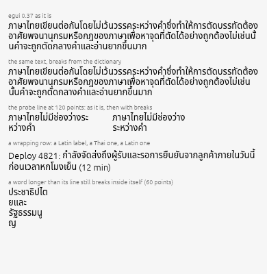

# Thai lines that break between words in `blocks-desktop` (#306)

## Summary

Decision: egui keeps doing the wrapping. `blocks-desktop` finds the word boundaries in Thai text with the ICU4X
segmenter's bundled dictionary, puts an invisible zero-width space egui may break at on each one, and takes them out
again once egui has laid the text, so copied text and screen readers get the text as written. Text with no Thai takes
egui's path untouched. A prototype draws it right.
Slices: one PR, about 230 lines: a baseline snapshot; the module and the probe test; every label through it, snapshots.
Open questions: the segmenter as a new dependency: 1.1 MB more in a release binary (the ADR has three smaller ways).

## The picture

`look/words-390.png`, drawn by the prototype with `blocks-desk`'s rasteriser at 390, Noto Sans Thai as the fallback
font. Top: the harness's Thai paragraph in egui 0.37 as it is (the second row ends inside `นั้น`), then through the
prototype. Then the issue's line at 120 points both ways, a Thai label flowing along a wrapping row between two Latin
ones, and a word longer than its line.

## The numbers in one table

| | egui 0.37 as it is | With the prototype's `words` |
|---|---|---|
| The issue's line at 120 points | `ภาษาไทยไม่มีช่องว่างระ`, `หว่างคำ`: **inside a word** | `ภาษาไทยไม่มีช่องว่าง`, `ระหว่างคำ` |
| Ten texts at four widths: the 22 that wrap | 10 break only at word ends | all 22, in three font set-ups |
| Thai that fits its row | | the same glyph places and the same PNG bytes as egui's own |
| Latin and CJK text | | not touched: the same galley egui holds |
| The line after `Status: ` in a wrapping row | starts a row below | goes on after it, then down a line |
| The line selected by a drag and copied | the text | the text: the gaps are taken out of the galley |
| A many-row text field with the layouter | breaks inside `ว่าง` | breaks between words; egui's keys work unchanged |
| Breaks for a 165-character paragraph | | 4 to 6 µs with the dictionary; 0.5 ms with the LSTM model |
| A pass of 200 Thai titles and 200 Thai paragraphs | 0.1 ms | 0.9 ms kept, 3 ms with nothing kept |
| A release binary | | 1.11 MB more (dictionaries for four languages; Thai is 132 KB of it) |
| The workspace's lock | 78 packages | 101; `cargo deny` passes |

## Read in this order

| File | What |
|---|---|
| `adr.md` | the question, what was found in egui and ICU4X, the options with their sizes, the decision in eight parts, the limits, the consequences, the open question, the exact `Cargo.toml`, `docs/deps.md`, `arch.toml` and rules lines |
| `usage.md` | how the callers read: a kind's file, a text field, an app's own kind, the tests, the harness |
| `design.md` | the data shapes, which module may call which and what enforces it, with and without #304, the statechart, the commits and what each proves |
| `measured.md` | every command and number, and what was not measured |
| `proto/` | the prototype: two crates outside every workspace, thrown away after the issue |

## What was read

- blocks `staging` at `3fe5208`: `crates/blocks-desktop/src/` (`draw/text.rs`, `prose.rs`, `row.rs`, `card.rs`,
  `message.rs`, `tool.rs`, `composer.rs`, `fallback.rs`, `look.rs`, `lib.rs`), `crates/blocks-desk/` (`lib.rs`,
  `raster.rs`, the tests and the Thai sample), `.drover/arch.toml`, `deny.toml`, `docs/deps.md`,
  `scripts/deps-gate.sh`, `.github/workflows/desktop.yml`, `docs/architecture/gpui/` (the spike's Thai probe).
- `docs/architecture/rtl/` on `issue-304` (`39d2519`), the right-to-left ADR this builds on. It is in review, not
  approved, so `design.md` gives both orders.
- The sources of `epaint` 0.37.0 (`text/text_layout.rs`, `text_layout_types.rs`, `unicode.rs`, `font_face.rs`), egui
  0.37.0 (`widgets/label.rs`, `widget_text.rs`, `text_selection/`) and `icu_segmenter` 2.4.0 with its data crate
  (`line.rs`, `complex/mod.rs`, the dictionary and LSTM data).
