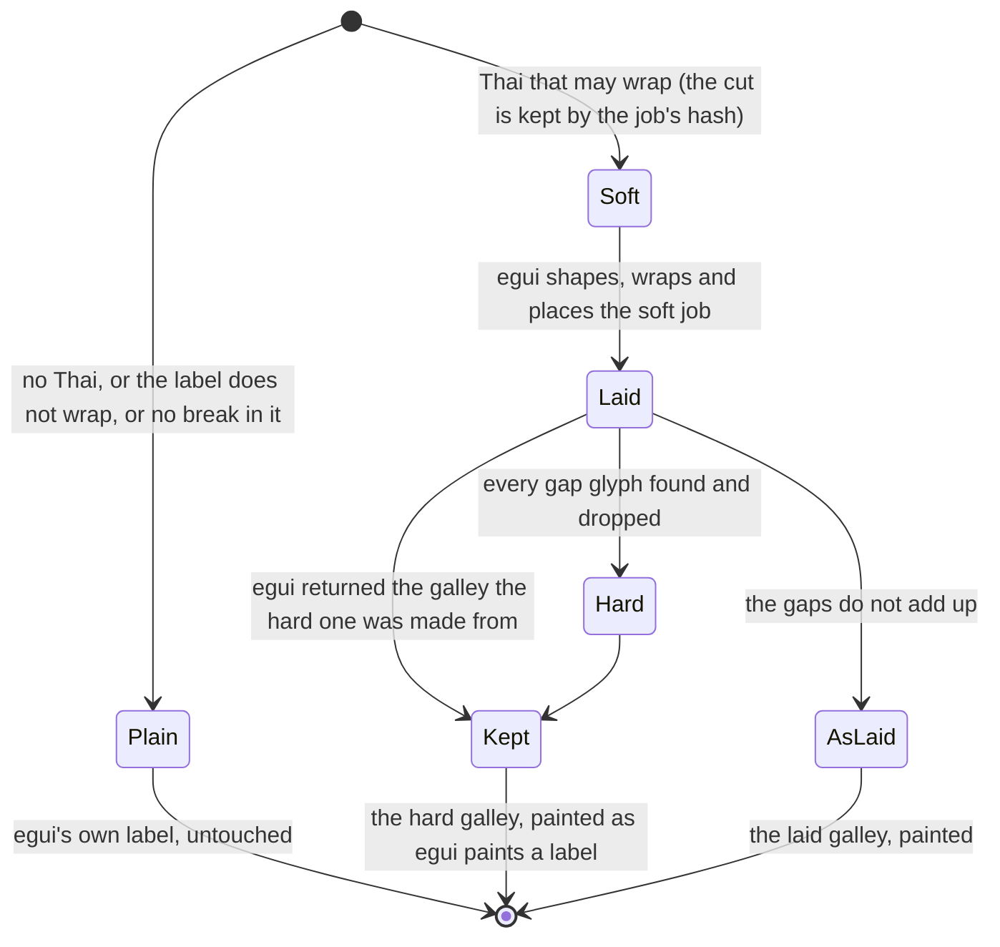

# Design: the shapes, the boundaries, the states, the slices (#306)

`proto/src/words.rs` is a working sketch of sections 1 and 3 (246 lines, no lints, with a switch between the
dictionary and the LSTM that the real module does not have). It is thrown away; the names below are the ones to build.

## 1. Shapes

`crates/blocks-desktop/src/words.rs`, one file, `pub mod words` in `lib.rs`:

```rust
/// Where a line may break inside the Thai of `text`: byte offsets, each between two Thai characters.
pub fn breaks(text: &str) -> Vec<usize>;

/// `ui.label(text)`, with Thai in a label that wraps breaking between words.
pub fn label(ui: &mut Ui, text: impl Into<WidgetText>) -> Response;

/// The same, sensing: a card's tappable title.
pub fn sensing(ui: &mut Ui, text: impl Into<WidgetText>, sense: Sense) -> Response;

/// The same as a link that opens `url`: prose's.
pub fn link(ui: &mut Ui, text: impl Into<WidgetText>, url: &str) -> Response;

/// `layout_job(job)`, with Thai breaking between words: a many-row text field's layouter, an app's own kind.
pub fn lay(ui: &Ui, job: LayoutJob) -> Arc<Galley>;
```

Inside the module:

```rust
/// A job with a gap after each Thai word, and what undoes them.
pub(crate) struct Soft {
    /// What egui lays: the caller's job, its sections cut at each break, a gap section between the pieces.
    pub(crate) job: LayoutJob,
    text: String,                    // the caller's text
    sections: Vec<LayoutSection>,    // the caller's sections
    gaps: usize,
}

impl Soft {
    /// None when the text has no Thai break, or the job is cut to a number of rows.
    pub(crate) fn of(job: &LayoutJob) -> Option<Self>;
    /// The laid galley without its gap glyphs, its job the caller's again. None when the gaps do not add up.
    pub(crate) fn harden(&self, laid: &Galley) -> Option<Galley>;
}

/// What is kept between passes, in the context's temp data. An entry not used for a pass is dropped.
#[derive(Clone, Default)]
struct Kept {
    /// By the hash of the caller's job: its soft job, or none for a text with no break.
    cut: HashMap<u64, (Option<Arc<Soft>>, u64)>,
    /// By the address of the galley egui laid: that galley and the hard one made from it.
    set: HashMap<usize, (Arc<Galley>, Arc<Galley>, u64)>,
}
```

Rules the shapes carry:

- **A gap** is U+0020 in a section of its own, with the format of the section it cuts, font size `1e-6` and no line
  height. A glyph is a gap when it is a space whose `font_height` is at most `4e-6`. No real text is that small, and
  a size of 0 panics in `epaint`.
- **A break** is one of ICU4X's line breaks (`LineSegmenter::new_dictionary`) where the character before and the one
  after are both in U+0E01 to U+0E5B, the one after is not U+0E2F, U+0E30 to U+0E3A or U+0E45 to U+0E4E, and the one
  after that is not U+0E4C. A text with no byte pair `E0 B8` or `E0 B9` is not handed to ICU4X at all.
- **Gaps are found by what they are, never by counting characters.** egui lists three glyphs for `คำ` (`adr.md`,
  fact 8), so a row's glyphs do not count its characters.
- **The hard galley's job** is the laid job with the caller's text and sections back. The first section keeps the
  laid job's `leading_space`, and the wrap width, alignment and first row height stay the laid job's: `Label` writes
  them for a label in a wrapping row.
- **The hard galley is egui's own in all but its rows.** Its text is the caller's, its glyph lists are what egui
  lists for that text, its mesh is untouched. Measured: not wrapped, it is the galley egui makes, glyph for glyph.
- **`set` holds the laid galley**, so its address cannot be given to another galley while the entry lives; an entry
  is used only if `Arc::ptr_eq` says the laid galley is still that one. egui drops its galleys when the font atlas
  is rebuilt, and then the entry is remade.

## 2. Boundaries

| Module | May call | May not | Enforced by |
|---|---|---|---|
| `words.rs` | egui, `icu_segmenter` | `look`, `cx`, `stage`, a kind, the `blocks` crate | the new `desktop-words` layer |
| `draw/**`, `fallback.rs`, `art.rs`, `island.rs`, `stage.rs` | `words::label`, `sensing`, `link`, `lay` | `ui.label(`, `hyperlink_to(`, `icu_segmenter` | the three bans |
| `bidi` (#304), if it has landed | `words::label`, `sensing`, `link`; `Soft::of` and `harden` around its own `layout_job` | `icu_segmenter` | `desktop-bidi` may use `desktop-words`; the ban |
| `blocks-desk` | `blocks_desktop::words::lay` and `breaks` in its tests | `icu_segmenter` | the ban |
| the `blocks` crate, `blocks-cli` | nothing here | `icu_segmenter` | the ban |

`breaks`, `Soft::of` and `harden` are pure: text or a job in, offsets, a job or a galley out. The unit tests drive
those. `label`, `sensing`, `link` and `lay` take a `Ui` for the fonts and the kept map.

A label that does not wrap is not a `words` label: `Label::new(..).truncate()` (a message's name, a tool's head)
stays as it is, and so does `Button`.

### With and without right-to-left (#304)

| | #304 has landed (the queue's order) | #304 has not |
|---|---|---|
| What a kind calls | `bidi::label`, `para`, `text`, as #304 left it | `words::label`, `sensing`, `link` |
| Plain text in `bidi` (no right-to-left character) | `words::label` where it called `ui.label`; a card's sensing title and prose's link likewise | not there |
| A text with both scripts | `bidi` softens the job it shapes and hardens the galley egui lays, before it places the rows | not there |
| The `ui.label(` ban | #304's, with `words.rs` added to its `except` | added here, `words.rs` its only `except`; #304 moves it |

Either way there is one door for kinds, and `words` is the only module that names the segmenter.

## 3. States

A label, each pass:



- `Plain` is `ui.add(Label::new(text))` with the caller's value: no job is made, nothing is kept.
- `AsLaid` cannot happen with egui 0.37 as measured; it is the guard for an egui upgrade. The label still breaks
  between words, but its copied text and its AccessKit name have the gaps, and the tests in section 4 fail.
- `words::lay` has the same states, except that in `AsLaid` it returns egui's own layout of the caller's job: a text
  field's galley must hold the field's text.
- Painting is what `Label` does after its layout: the role and name, the text colour of the sense, the selection
  (`LabelSelectionState::label_text_selection`) or a `TextShape`. `link` adds the pointing hand and `open_url`.

## 4. Slices

One issue, one PR: a baseline commit, then two slices. Line counts are non-test lines.

| | Commit | What | Proves | Lines |
|---|---|---|---|---|
| 0 | baseline | A Latin and CJK screen (a text, a row, a card) with its 390 PNGs in light and dark as staging draws them, and the test that compares bytes. Skipped if #304's `tests/scripts/` baseline is already there | AC 3: these files, and #304's right-to-left ones, do not change again in the PR | 0 |
| 1 | `words` | The dependency with its lines in `docs/deps.md` and `arch.toml`; `breaks`, `Soft`, `Kept`, `lay` | AC 1: `crates/blocks-desk/tests/thai.rs`, the issue's line at 120 points with the Thai font breaks only at the ends of its eight words, and not at all at 390; text with no Thai is egui's own `Arc`; Thai not wrapped has egui's own glyph places; the hard galley's text is the caller's; a word wider than its line still breaks; a many-row `TextEdit` with `lay` as its layouter takes keys | +130 |
| 2 | every label | `label`, `sensing`, `link`; each `ui.label(` (29 in 14 files), the card's title and prose's link through them; the bans and the rules line; `tests/thai/screen.json` grown to a text, a prose with a bold span and a link, a row, a card, a message and a tool with a body, and its 390 PNGs in light and dark | AC 2: the snapshot test on the three OSes; the sample holds every kind the issue lists; a drag over a wrapped label and a copy give its text; a Thai case in `tests/perf.rs` | +100 |

Notes for the lane:

- **Use `Label::layout_in_ui`, never a galley made beforehand**, for a label: a ready galley gets one box, and a
  Thai span in a prose paragraph would stop flowing after the span before it.
- **Check `ui.wrap_mode()` first.** Only `Wrap` is softened: `Extend` breaks nothing, and `Truncate` gives its `…`
  the format of the last glyph it keeps, which may be a gap. A galley the caller laid itself (a message's time) is
  egui's too.
- **Push sections; do not `append`.** Each piece and each gap is a section of its own.
- **`Kept` needs no lock**: one `ui.data_mut` closure does the lookup and the work (`Soft::of` and `harden` are pure
  and call nothing in the context). The address is `Arc::as_ptr(..).addr()`, not an `as` cast.
- **Map rows to text in the probe test by glyph count, `ำ` counting two.** The issue's line has its only `ำ` last, so
  every row end is exact. The prototype's `lines` does this.
- **The snapshots are 390 wide and as tall as the sample**, not 844: the harness's PNGs are not compressed.
- **`demo/egui/Cargo.lock`** is its own lock and needs the new packages.
- **If #304 has landed**, add a text with Hebrew and Thai to its sample and hold its rows to Thai word ends.
