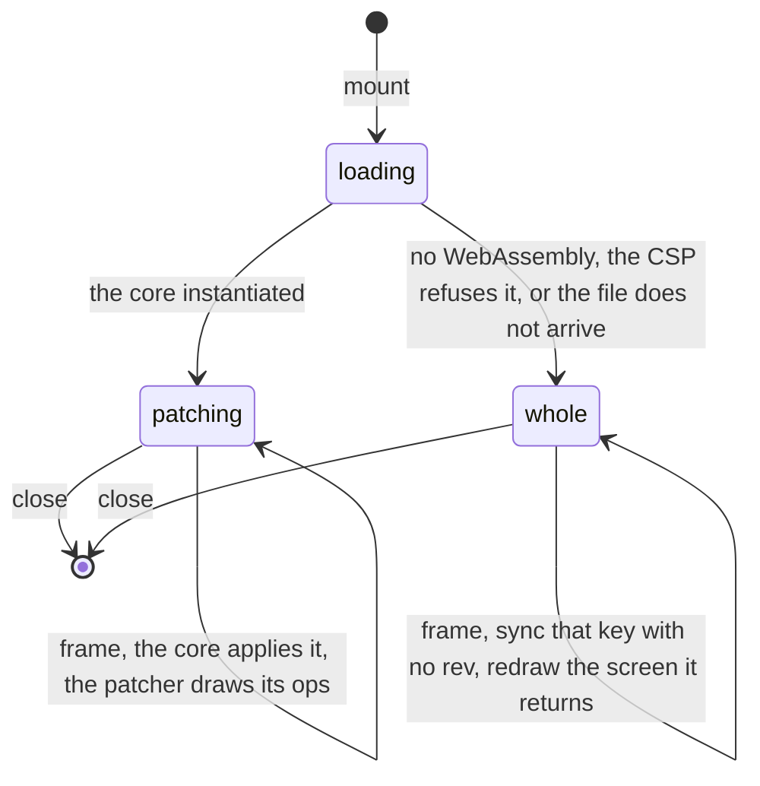

# The design that was measured (#46)

Not to be built: the ADR is a no-go. This is the shape the prototype had, kept so a later look starts from it, and
so the owner can see what a go would mean.

## The callers' usage

```ts
const core = await load(o.wasm);                 // core.ts; undefined where wasm cannot load
const s = stream({ url, core, state });          // shell.ts: `mount` stays synchronous, the stream waits for `load`
s.open(key, (screen, ops) => patch.queue(ops));  // unchanged for the shell

const took = mirror.frame(e.data);               // stream.ts: the frame's text goes in as it arrived
const screen: Block = JSON.parse(mirror.screen(k) ?? "null");   // once per key per animation frame

const v: View = JSON.parse(core.view(screenText, JSON.stringify(state)));   // behave.ts
```

`stream.ts` keeps `EventSource`, `fetch` and the animation-frame queue; `patch.ts` keeps the DOM patcher;
`behave.ts` keeps its two listeners. `Mirror`, `apply`, `evaluate`, `start` and `view` leave the TS.

## Data shapes

Text in, text out. Every string is the JSON of a type `web/src/gen/types.ts` already has; no new wire shape.

```ts
export type Core = {
  mirror(v: number): CoreMirror;
  apply(screen: string, ops: string): string | undefined;
  diff(old: string, next: string): string | undefined;
  evaluate(expr: string, state: string): string;
  start(screen: string): string;
  view(screen: string, state: string): string;
};
export type CoreMirror = {
  hello(hello: string): Outdated | undefined;
  open(k: string): void;
  close(k: string): void;
  have(): string;
  frame(frame: string): Took;
  synced(sent: string, synced: string): string;
  screen(k: string): string | undefined;
  free(): void;
};
```

The screen lives twice: typed in the wasm's memory, and as the object the renderers draw.

## Module boundaries

| Module | May call | Never |
|---|---|---|
| `crates/blocks-wasm` (new leaf `cdylib`, the only place `wasm-bindgen` is named) | `blocks`: `expr`, `kind`, `built`, `wire`, `patch`, `diff`, `mirror`, `behave` | be depended on; `site`, `theme`, `layout`, `shelf`, `tree`, `web` |
| `crates/blocks` | as today | `wasm-bindgen`; and `blocks::web` is compiled out on wasm, since it embeds the bundle |
| `web/src/core.ts` (new) | `WebAssembly`, the generated glue | the DOM, the network beyond fetching the one `.wasm` |
| `stream.ts`, `patch.ts`, `behave.ts`, `shell.ts` | `core.ts` | `WebAssembly` |
| `web/src/render/**` | as today | `core.ts` |

Apps see none of it in Cargo: a git pin pulls `blocks` alone, so `wasm-bindgen` never enters their lock files.

## The loader's states



`whole` needs no second core and no protocol change: a `have` with no rev already returns the whole screen. In it
`show`, `enabled` and checks do not run on the page; the server's own answer to a submit stands in, as on a page
`site` wrote.

## Build

`just gen` gains two steps before esbuild: `cargo build -p blocks-wasm --target wasm32-unknown-unknown` with the
profile in `measured.md` and a path remap, then the `wasm-bindgen` CLI (`--target web`) writing the glue into
`web/src/gen/` and `web/dist/blocks.wasm`. `blocks::web::WASM` includes that file. Dev hosts and CI's `gen` job
each need the target and the CLI at the crate's exact version.

## `.drover/arch.toml` lines, were it built

```toml
generated = ["web/dist/blocks.wasm", "web/src/gen/core.js", "web/src/gen/core.d.ts"]

[[layer]]
name = "wasm"
paths = ["crates/blocks-wasm/src/**"]
mods = ["blocks_wasm"]
may_use = ["expr", "kind", "built", "wire", "patch", "diff", "mirror", "behave"]

[[ban]]
pattern = "WebAssembly"
paths = ["web/src/**"]
except = ["web/src/core.ts", "web/src/gen/core.js"]
reason = "one loader: core.ts instantiates the wasm core; nothing else compiles code"

[[ban]]
pattern = "wasm-bindgen"
paths = ["crates/blocks/Cargo.toml"]
reason = "the crate apps pin stays serde only: the wasm tool lives in blocks-wasm"
```

The three `generated` entries join the existing list; `generate = "just gen"` stays.
