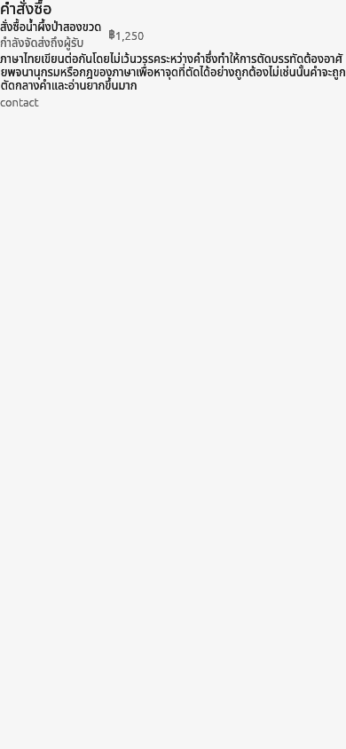

# The desktop renderer: what egui draws wrong

The renderer (`crates/blocks-desktop`) and its harness (`crates/blocks-desk`) follow
`docs/architecture/desktop/`. These are egui 0.37's own defects. The renderer does not work around them; each
waits for an egui release that fixes it.

## Right-to-left text

egui does not lay out right-to-left text: Arabic and Hebrew draw left to right. The web and SwiftUI renderers are
unaffected.

## Thai

Measured with the harness at 390 and 1440, with Noto Sans Thai given by `--font`
(`crates/blocks-desk/tests/thai/`; egui's own fonts have no Thai glyphs, so an app must give one):

- Shaping looks right in the PNG: tone marks and vowels above and below sit on their base consonant and stack (`น้ำ`, `ผึ้ง`,
  `ซึ่ง`, `นุ`).
- Line breaks are wrong: egui breaks a line only at a space or, failing that, at the last character that fits. Thai
  puts no space between words, so a long Thai line is cut inside a word (`อาศั` / `ย`). The other two renderers
  break between words.

